# JevX Architecture

**Scope.** Layered architecture of the JevX conversion+decision pipeline, the eleven named
components, twelve diagrams (conversion paths per modality, conditioning, parallelism,
calibration, abstention, training), the two training modes, and the honest distinction between
*representation reuse* and *weight transplant*. Labels: [FACT] observable in this
repository/vendor tree; [DESIGN] a choice of this project; [HYPOTHESIS] — see
``RESEARCH.md`` `12`. Mathematical objects referenced as Def. *n* / T*n* are defined in
``MATHEMATICAL_SPECIFICATION.md`` and proved in ``PROOFS.md``.

**Repository status note [FACT — updated 2026-09-24]:** the Phase-2 note that ``jevx/`` was
an empty skeleton is stale: the package is now implemented and the design below describes the
code as built (reference: docs/API.md; suite counts in docs/TESTING.md §1 — the pre-fix-wave
runs quoted there measured 768 passed, 1 skipped; the fix wave collects 828 and its verbatim
summary is refreshed in reports/FINAL_VERIFICATION.md).

---

## 1. Layers

| Layer | Name | Contents | Failure if absent |
|---|---|---|---|
| L0 | **Substrate** | Python 3.14, torch 2.14.0+cpu, ``transformers`` 5.16.1 (audited vendor tree ``vendor/transformers`` [FACT]) | — |
| L1 | **Model & capability** | `CapabilityRegistry`, `ModelAdapter` — which model, what modality, what pooling, support level 0–4 | silent misuse of an incompatible backbone |
| L2 | **Input & representation** | `InputAdapter` (tokenize/featurize + masks, Def. 1), `RepresentationAdapter` (backbone forward + pooling choice, Def. 4) | garbage hidden states; padding leaks |
| L3 | **Question & schema & fusion** | `QuestionEncoder` (Def. 2→4), `SchemaEncoder` (Def. 3→4), `DecisionFusion` (Def. 5) | unconditioned decisions; wrong option wiring |
| L4 | **Typed decision** | `TypedDecisionHeads` ($G_{\text{type}}$, $\Pi_{\text{type}}$, Defs. 6–7) | outputs outside the declared type |
| L5 | **Post-processing & guardrails** | `CalibrationEngine` (Def. 8), `ConfidenceEngine` (Def. 9, abstention Def. 10), `ValidationEngine` (invariants D8.I, (11.3), T7 tolerances) | uncalibrated thresholds; schema drift after calibration; uncaught type escapes |
| L6 | **Training** | `training` subpackage: Mode A / Mode B loops (`6` below) | heads untrainable/untunable |
| L7 | **Auto layer** | `auto`: model-class resolution via the vendor auto mappings [FACT: ``vendor/reports/auto_model_mapping.json`` keyed by ``model_type``] | hand-wired model loading, brittle across 510 families |

Data flows downward-to-upward as: raw state/question/schema → tensors → hidden states →
logits → probabilities → calibrated typed decision (+ confidence/abstention side-channel).

---

## 2. Components (eleven named)

| Component | Responsibility | Consumes → produces | Owns invariants |
|---|---|---|---|
| **CapabilityRegistry** | Probes a model class for: input modality, hidden-state availability, mask support, pooling options; assigns support level 0–4 (`7`) | model id → capability record | conversion refused below level 1 |
| **ModelAdapter** | Loads backbone weights (reuse path), places in eval mode, exposes one `forward_states(X, M) → (Z, M)` interface across architectures | checkpoint → uniform hidden states | eval-mode determinism (A7.1) |
| **InputAdapter** | Modality featurization: tokenization / image processing / audio feature extraction; padding + masks (Def. 1) | raw $S$, $Q$ text → $(X, M)$ | axioms D1.1–D1.4 |
| **RepresentationAdapter** | Chooses pooling per capability record (Def. 4a–e); retains unpooled sequence when cross-attention needs it | $(Z, M)$ → $H_S$ / $H_S^{\text{seq}}$ | mask respect P4.2, padding invariance P4.3 |
| **QuestionEncoder** | Encodes $Q.\textit{text}$ — default hashed bag-of-tokens projection (never touches the backbone, preserving the one-forward property); optional `method="backbone"` mode runs a shared/separate text backbone (extra forward — spec Def. 4), pools to $h_Q$ | $Q$ → $h_Q$ | metadata non-interference D2.2 |
| **SchemaEncoder** | Encodes each option independently ($k \mapsto H_{C,k}$), schema order preserved; option-axis mask for $K$-padding | $C$ → $H_C \in \mathbb{R}^{K\times d}$ | schema axioms D3.1–D3.4 |
| **DecisionFusion** | One of five variants (Def. 5a–e — concat, gated, additive, bilinear, cross-attention — all registered under `fusion_type`, plus `dot`/`mlp` extras; `FUSION_REGISTRY` in `jevx/representations/fusion.py`); pure function of $(H_S, h_Q, H_C)$ (cross-attention additionally consumes the retained state sequence). The $s_C$ schema-summary summands of 5.a–5.d are carried by the per-option formula ($e_k = g \odot W_o H_{C,k} + (1-g)\odot c$) instead — no $\phi_C(s_C)$ term (spec 5: "implementation form is normative") | states → logits $z \in \mathbb{R}^K$ | purity D5.1 (feeds T7) |
| **TypedDecisionHeads** | $G_{\text{type}}$ (softmax/sigmoid/cumulative/PL, Def. 6) and $\Pi_{\text{type}}$ (Def. 7) selected by $Q.\textit{type}$ | logits → typed decision | T1–T4, T8 membership |
| **CalibrationEngine** | fit (8.3/8.4) on held-out cal set; calibrate at inference; evaluate (8.5) | $(z, y)_{\text{cal}}$ → fitted calibrator; $p \to p'$ | type/schema preservation D8.I |
| **ConfidenceEngine** | Functionals (9.1)–(9.4); abstention overlay (10.1)–(10.4) | $p'$ (or $z$) → $c$, risk–coverage stats | confidence ≠ correctness (non-claim #2) |
| **ValidationEngine** | Runtime assertions: schema-hash equality across calibration; type-tag equality; per-question $\sum_i p_i = 1 \pm$ tol; masked $p = 0$; T7 batch-vs-loop tolerance checks in tests | every boundary call | D8.I, (11.3), implementation invariants |

Module locations reserved [DESIGN]: `jevx/adapters`, `jevx/representations`,
`jevx/questions`, `jevx/decisions`, `jevx/calibration`, `jevx/confidence`,
`jevx/capabilities`, `jevx/training`, `jevx/conversion`, `jevx/auto`, `jevx/utils`.

---

## 3. Diagrams (12)

### 3.1 Overall JevX

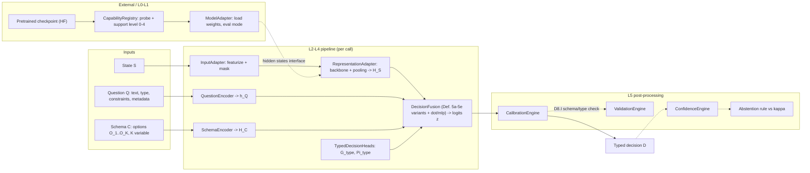

*Caption.* Solid arrows: data path. Dotted: control/monitoring. Note the single fan-in of
`H_S` into `FUS` (computed once — Def. 11) and that `CalibrationEngine` sits strictly
between probability construction and typed projection (Eq. 7.9).

### 3.2 Decoder-only conversion (GPT-family, causal LMs)

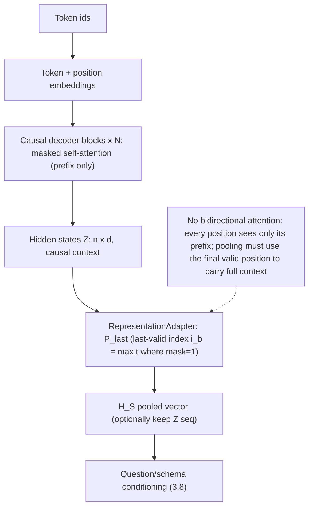

*Notes.* [FACT] Causal LMs expose last hidden states through the common output contract
(``BaseModelOutput``, ``vendor/transformers/src/transformers/modeling_outputs.py``).
[DESIGN] `P_last` (Def. 4d) is the default; `P_mean` over valid positions is a fallback
probed by the registry.

### 3.3 Encoder conversion (BERT-family, bidirectional)

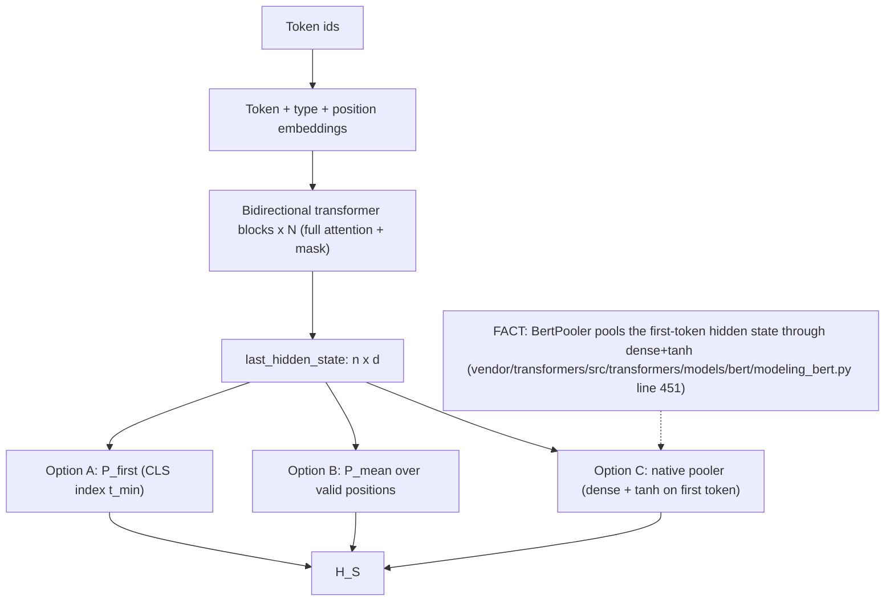

*Notes.* [DESIGN] registry probes which of A/B/C the model provides; mean-pooling is the
portable default, native poolers are used when exposed.

### 3.4 Encoder-decoder conversion (BART/T5-family)

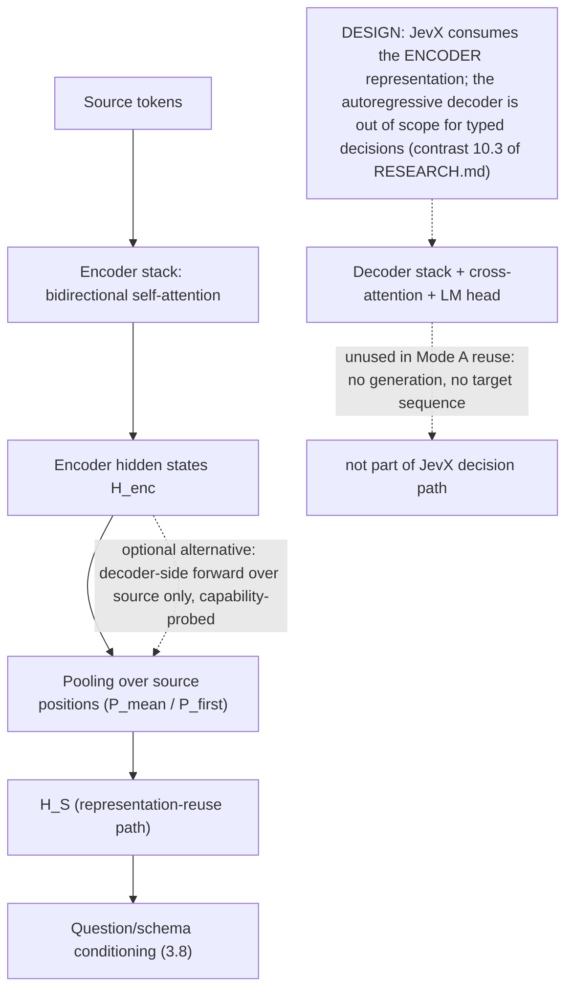

*Notes.* [DESIGN] two capability-probed sub-options: (a) encoder forward only (default),
(b) full model forward with a minimal prefix to exercise decoder-side layers — never
free-text generation. Registry records which sub-option the checkpoint supports.

### 3.5 Vision conversion (ViT-family, patch models)

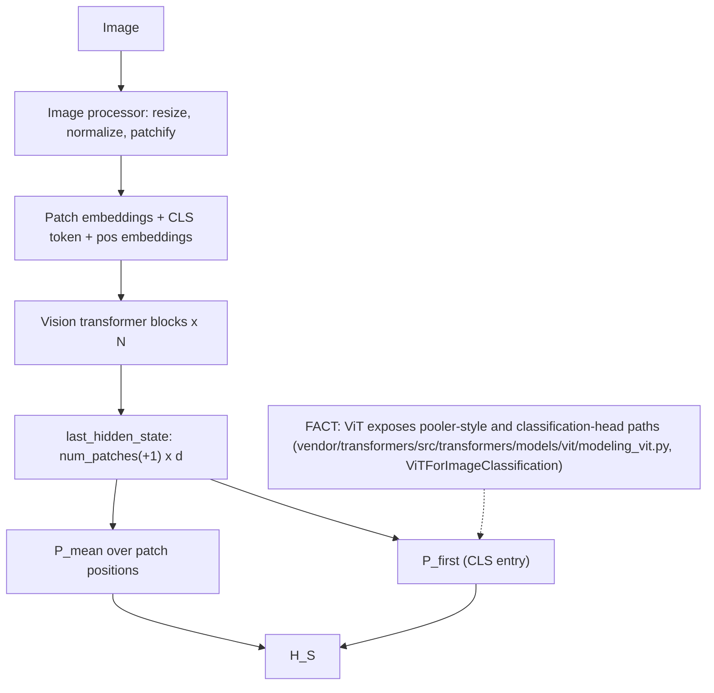

*Notes.* Question text still flows through `QuestionEncoder`; only the *state* tower is
vision (the question stays textual — [DESIGN] default; image-conditioned questions are a
registry-flagged extension, unimplemented).

### 3.6 Audio conversion (spectrogram/frame models)

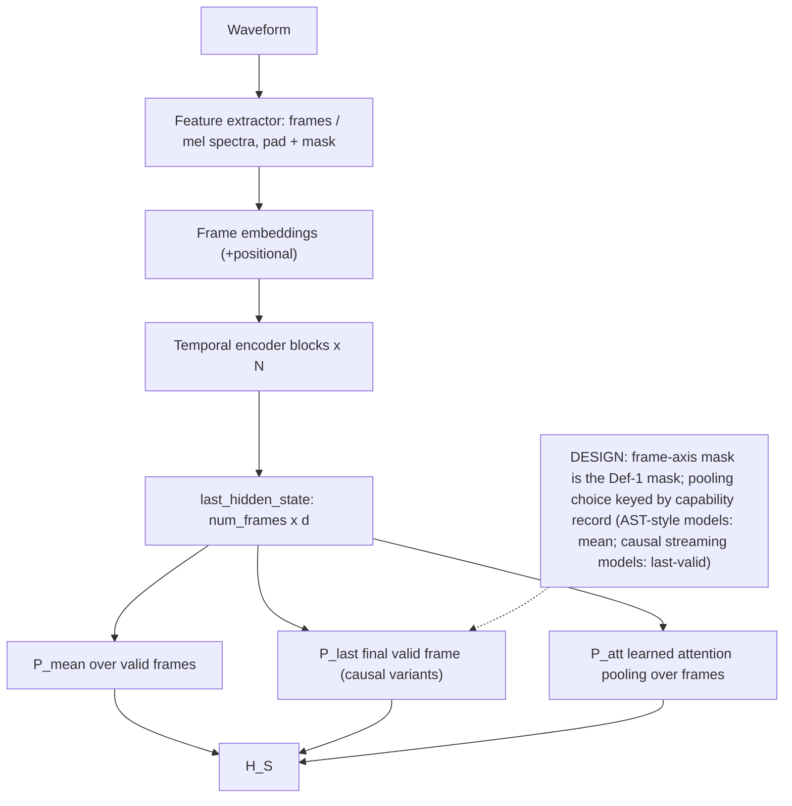

*Notes.* [FACT] audio model families present in the audited tree include
``audio_spectrogram_transformer``, ``wav2vec2``, ``whisper``, ``encodec`` under
``vendor/transformers/src/transformers/models/``. Support level still 0 until probed.

### 3.7 Multimodal conversion (dual-tower, CLIP-family)

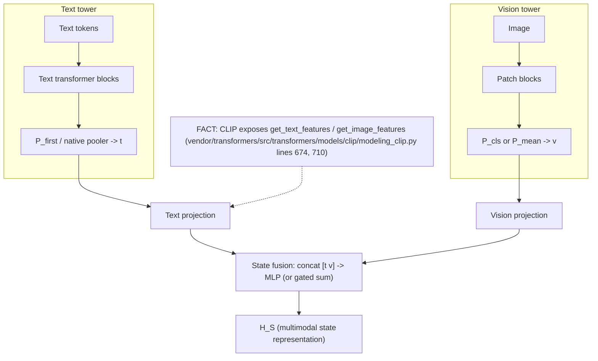

*Notes.* [DESIGN] two sub-modes: (a) *joint-state*: towers fused once into a single $H_S$
shown here; (b) *tower-selective*: capability record maps question modality to the tower
that conditions it. Both keep Def. 11 semantics (one shared $H_S$ per state, per-question
purity).

### 3.8 Question and schema conditioning

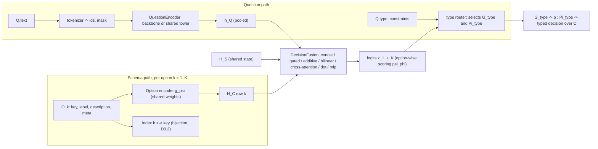

*Notes.* [DESIGN] Option encoder weights are shared across options and questions (variable-K
friendly, Def. 5.0). The type router is where `Q.type` first touches the math: it selects
both the probability map and the projection, so an incorrectly declared type is a declared
contract violation (AS8), caught by schema/type validation rather than silently coerced.

### 3.9 Parallel inference (shared H_S, J questions)

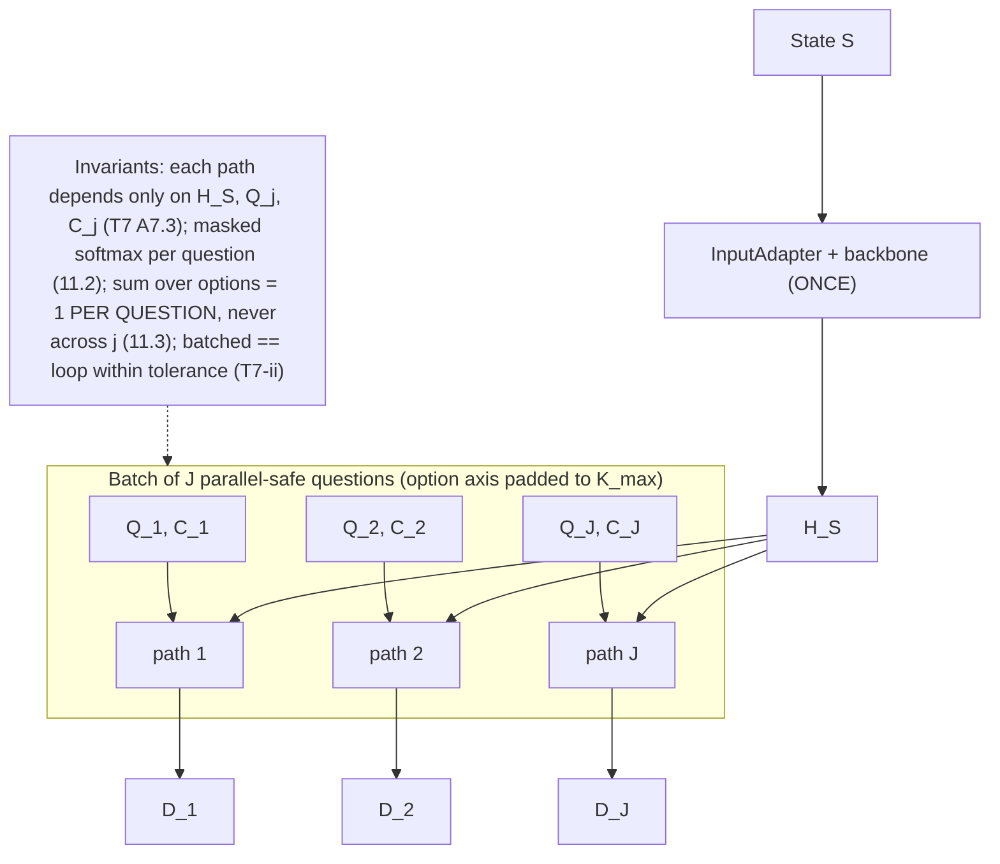

*Notes.* [DESIGN] Functional independence only: outputs are not statistically independent —
shared `H_S` and shared parameters couple them (P11.2; see LIMITATIONS).

### 3.10 Calibration

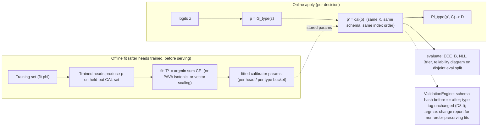

*Notes.* [DESIGN] Calibration is *post-hoc and disjoint*: never trained jointly with heads
(DC-10); the fit/eval protocol is Def. 8. The guard exists because D8.I is an invariant to
enforce, not merely to hope for.

### 3.11 Abstention (confidence threshold, risk-coverage)

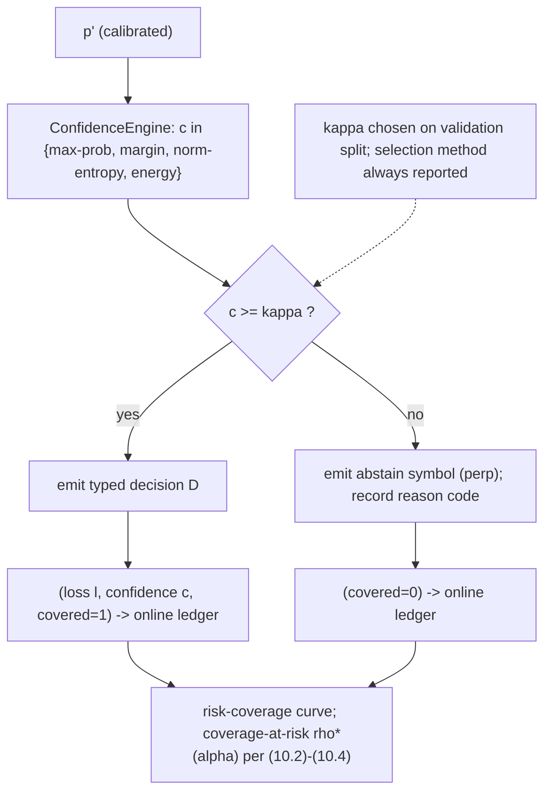

*Notes.* [DESIGN] Threshold semantics per (10.1); the ledger records everything needed for
Def. 10 reporting without recomputation. [STATISTICAL] Any risk number read off this curve
is a sample estimate under exchangeability — not a per-instance guarantee (non-claim #2).

### 3.12 Training (Mode A and Mode B)

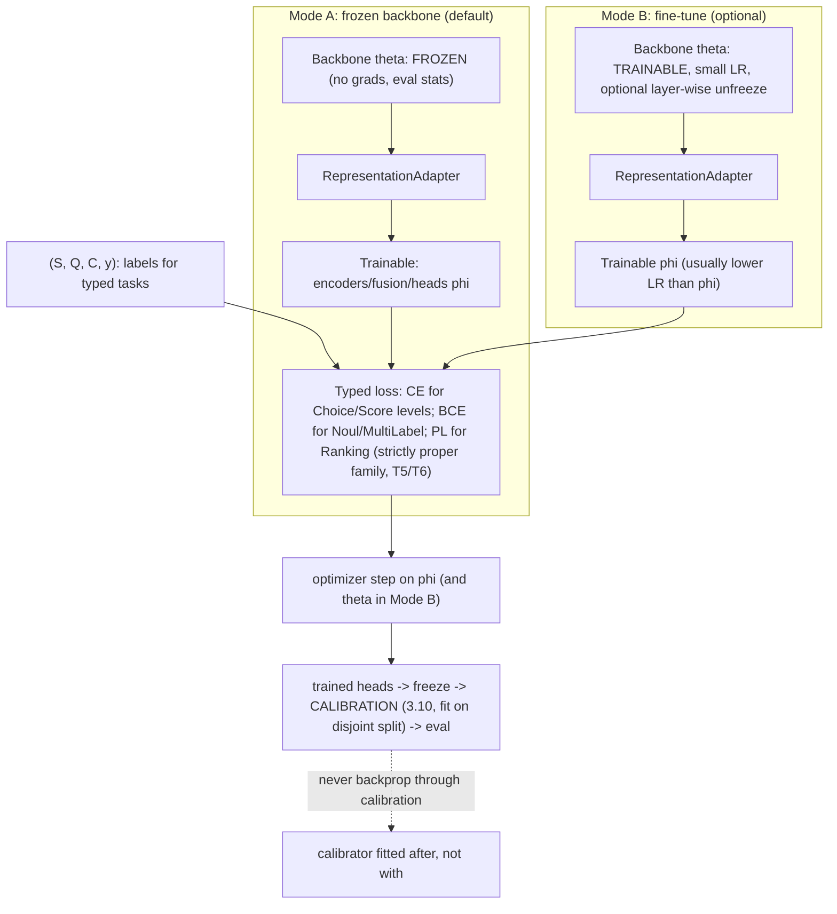

*Notes.* [DESIGN] One loss line, two modes: the loss never sees the calibrator; calibration
always comes after (D8.I placement). Mode B adds optimizer state over the backbone — on the
CPU-only box this caps practical model size (LIMITATIONS).

---

## 4. Training modes: Mode A (frozen backbone) vs Mode B (fine-tuned)

| Dimension | Mode A — representation reuse, frozen | Mode B — fine-tuned |
|---|---|---|
| Backbone parameters $\theta$ | frozen: not in optimizer, `eval` mode, gradients blocked | trainable: included in optimizer, usually smaller LR than heads; optional layer-wise unfreeze schedule |
| Trainable parameter count | adapters + encoders + fusion + heads ($O(d^2)$-scale at most) | + backbone ($O(\text{params})$) |
| What is preserved | pretrained representation *by construction* (identical weights, identical outputs for identical inputs) | representation drifts by gradient descent — measurable via probe/regression suite |
| Catastrophic forgetting | impossible for $\theta$ (never updated) | possible; controlled only empirically (H3) |
| Compute on this box (CPU-only) | feasible for adapter-scale training on small/medium backbones | constrained: gradient+optimizer memory over full backbone; large models impractical [FACT: 4 threads, ~8 GB RAM] |
| Calibration | fitted post-hoc either way | fitted post-hoc either way (never joint) |
| Default | **yes (DC-2)** | opt-in per experiment, must report forgetting checks |

[DESIGN] Both modes share the identical L2–L5 stack; only the optimizer's parameter groups
differ, which keeps ablations apples-to-apples (H2).

---

## 5. Representation reuse vs weight transplant (the honest distinction)

**Claim in one line:** JevX performs **representation reuse** with *surgical* weight
transplant where a genuine counterpart exists; a true 1:1 weight conversion of the *whole
system* is **impossible**, because most of the decision system has no pretrained weights to
convert.

**What "conversion" can and cannot mean here.**

1. **Backbone (possible, 1:1).** Loading a checkpoint's encoder/decoder weights into the
   same architecture is a genuine identity map: every pretrained tensor maps to itself
   (`safetensors` keys unchanged). [FACT] `transformers` itself performs weight conversion
   only *between related architectures/versions* through explicit mapping tables (observed:
   ``vendor/transformers/src/transformers/conversion_mapping.py``, ``core_model_loading.py``,
   ``safetensors_conversion.py``) — none of these invents weights; they relocate existing ones.
2. **New heads (impossible, 1:1 by construction).** `DecisionFusion`, `TypedDecisionHeads`,
   `CalibrationEngine` (fitted parameters), `ConfidenceEngine` thresholds, and the encoders'
   pooling projections are **new modules with no counterpart in the source checkpoint**. There
   is no pretrained tensor named for a schema-conditioned bilinear fusion of
   $(H_S, h_Q, H_C)$ because the checkpoint never saw questions or schemas. Their weights are
   *initialized* (fresh) and *learned* (Mode A/B) — not converted. Claiming a bijection here
   would be a category error, and this project does not make it.
3. **Head grafting (possible, narrow).** When the source checkpoint *does* contain a
   compatible task head (e.g., a fine-tuned classifier with matching output dimension, or a
   pooler with matching shape), JevX may transplant those tensors as initialization for the
   corresponding adapter piece — a *warm start*, still subject to validation. This is
   reported as transplant, never as identity: shapes must match exactly, semantics are
   re-checked, and the transplanted head is re-fit or frozen by explicit config.
4. **Vocabulary/tokenizer and processor** are reused as-is (they are data-contract, not
   weights), pinned by version to the audited tree. [FACT]

**Terminology used in JevX docs** [DESIGN]:
`conversion` = capability probe + architecture wrap + backbone load (+ optional grafting)
+ fresh head init — *not* "the checkpoint becomes a decision model bit-for-bit". Where a
simpler statement is needed: *the backbone is transplanted; the decision system is built
around it.*

---

## 6. CapabilityRegistry and support levels (0–4)

[DESIGN, referenced by LIMITATIONS] Each probed `model_type` (from the audited auto-mapping
of 510 families [FACT]) gets exactly one level.

**Normative scale — one source of truth.** The definitions of levels 0–4 live in the
"Support levels (defined precisely)" table of
[TRANSFORMERS_COMPATIBILITY_MATRIX.md](../TRANSFORMERS_COMPATIBILITY_MATRIX.md) (repo
root). That table wins any conflict with any other document; this section and
``LIMITATIONS.md`` §7 only re-state it. Quoted once, condensed:

| Level | Meaning (condensed from the matrix's normative table) |
|---|---|
| **0 — Unsupported** | No standard extraction path through the public API (no audited family landed here). |
| **1 — Source-verified only** | Contract read in source but not forward-probed here, or the environment could not exercise the input pipeline, or the checkpoint is not HF-API verified. |
| **2 — Convention-dependent (lossy pooling)** | Extraction mechanics fully standard and probe-verified, but the pooled-vector semantics depend on a convention JevX must pin (which pooling, which layer, which positions); usable, quality is checkpoint- and pooling-choice-dependent. |
| **3 — Native states + standard pooling** | Forward output probe-verified; JevX applies one generic mask-aware pooling that is the established convention for the family; checkpoint HF-API verified — plus, per the Phase 92-94 evidence overlay, load → forward → save/load equality → output invariants → real-data input **executed on the cited checkpoint**. |
| **4 — Native pooled vector + quality gate** | A trained/pooled representation is a named output field, probe-verified, checkpoint HF-API verified — **plus a real-dataset quality result** (Accuracy/F1/NLL/Brier/ECE) for that family's checkpoint from the benchmark suite. |

Rules: levels are monotone (4 implies 3 implies 2 implies 1); a failure demotes to the
highest passing level; level 4 is always scoped to the environment it was measured in
(this CPU-only box — see LIMITATIONS). A registry entry is a **[FACT] only at the level the
evidence supports**; aspirational levels are never pre-assigned. Current headline
distributions (13 families at level 3, 7 at level 2, none at 1/0) are computed on this
matrix scale — see the matrix and ``reports/REAL_MODEL_VALIDATION.md``.

---

## 7. Grounding map (reserved module ↔ specification)

| Reserved location [FACT: directory exists] | Specification anchor |
|---|---|
| ``jevx/adapters`` | ModelAdapter, InputAdapter, RepresentationAdapter; Def. 1, 4 |
| ``jevx/representations`` | pooling operators P4.1–P4.3; Def. 4 |
| ``jevx/questions`` | QuestionEncoder; Def. 2 |
| ``jevx/decisions`` | SchemaEncoder, DecisionFusion, TypedDecisionHeads; Defs. 3, 5–7 |
| ``jevx/calibration`` | CalibrationEngine; Def. 8, D8.I |
| ``jevx/confidence`` | ConfidenceEngine, abstention; Defs. 9–10 |
| ``jevx/capabilities`` | CapabilityRegistry; levels 0–4 (section 6) |
| ``jevx/training`` | Mode A / Mode B; section 4 |
| ``jevx/conversion`` | conversion + grafting semantics; section 5 |
| ``jevx/auto`` | auto class resolution; `vendor/reports/auto_model_mapping.json` |
| ``vendor/transformers`` | audited L0 dependency, tag v5.16.1 |

All twelve diagrams above are design intent; no diagram implies code exists today.
