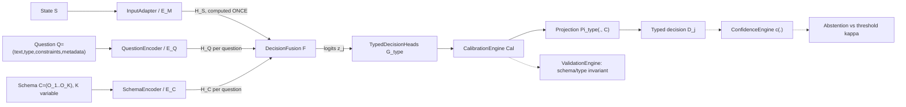

# JevX Mathematical Specification

**Status:** Phase 2 deliverable — formal specification. This document defines the mathematical
objects, maps, and invariants of the JevX pipeline. Proofs of the stated theorems live in
``PROOFS.md``; design rationale lives in ``RESEARCH.md``; component mapping lives in
``ARCHITECTURE.md``; scope caveats live in ``LIMITATIONS.md``.

**Labeling convention used across all JevX documents:**

| Label | Meaning |
|---|---|
| [MATH] | Deductive result: true under explicitly stated assumptions, in the stated arithmetic model |
| [DESIGN] | A design decision made by this project; not derived from evidence, may be revised |
| [FACT] | Directly observable in this repository/environment, or standard in cited literature |
| [HYPOTHESIS] | Expected behavior that must be validated empirically before being believed |
| [EMPIRICAL] | A claim supported by measurements; only valid with the accompanying numbers and setup |

No statement in this repository constitutes a claim that any JevX model is "correct",
"calibrated in deployment", or "better than alternatives" without accompanying empirical
evidence scoped to the tested setting.

---

## 0. Preliminaries and notation

* $\mathbb{N}$ = positive integers $\{1,2,\dots\}$. Sequences and schema indices are
  **1-based** (matching encoder/decoder token conventions); probability vector components
  in formulas are written $1..K$ to match schema indices.
* For $K \in \mathbb{N}$, the probability **simplex** is
  $\Delta^{K-1} = \{p \in \mathbb{R}^K : p_i \ge 0,\ \sum_{i=1}^K p_i = 1\}$; its interior is
  $\operatorname{int}\Delta^{K-1} = \{p: p_i > 0, \sum_i p_i = 1\}$.
* Logarithms are natural: $\ln$. Conventions: $\ln 0 = -\infty$, $0\cdot\ln 0 = 0$.
* $\sigma(z) = 1/(1+e^{-z})$ denotes the **sigmoid**; $\operatorname{softmax}(z)$ denotes the
  softmax map. Vectors are column vectors; $\mathbf{1}$ is the all-ones vector.
* **Arithmetic model.** Unless a remark says otherwise, every [MATH] statement is proved in
  exact real arithmetic. Floating-point (IEEE-754 binary32/binary64) deviations are called out
  explicitly as remarks; the unit roundoff of binary32 is $u = 2^{-24}$.
* $\arg\max$ is set-valued in general; JevX uses the **minimum-index tie-break**:
  $\operatorname{argmax}^{\min}(p) = \min\{i : p_i = \max_j p_j\}$, which is single-valued on
  any finite set.
* **Pipeline (fact about the design, [DESIGN]).** With backbone parameters $\theta$ and head
  parameters $\phi$ (collectively $\Theta = (\theta,\phi)$):

$$
H_S = E_{M}(S),\quad H_Q = E_Q(Q),\quad H_C = E_C(C),\quad
H = F(H_S, H_Q, H_C),\quad P = G_{\text{type}}(H),\quad P' = \mathrm{Cal}(P),\quad
D = \Pi_{\text{type}}(P', C).
$$

  and the JevX decision function is $J_\Theta(S,Q,C) = D$. Every map above is defined
  formally in Definitions 1–11.

---

## 1. Definition 1 — State space

**Definition 1 (State space).** Let $\mathcal{M} = \{\text{text}, \text{image}, \text{audio},
\text{structured}, \text{multimodal}\}$ be a modality index set. The **state space** is the
disjoint union

$$
\mathcal{S} \;=\; \bigsqcup_{\mu \in \mathcal{M}} \mathcal{S}_\mu ,
$$

where each $\mathcal{S}_\mu$ is the set of raw inputs of modality $\mu$ (Unicode strings for
$\mu = \text{text}$; finite real matrices for image/audio frames; JSON-serializable records for
$\mu = \text{structured}$; finite tuples thereof for $\mu = \text{multimodal}$).

An **InputAdapter** realizes a (deterministic) featurization

$$
R_\mu : \mathcal{S}_\mu \longrightarrow \mathcal{X}_\mu := \big(X, M\big),
\qquad X \in \mathbb{R}^{n \times d_{\text{in}}},\quad M \in \{0,1\}^{n},
$$

producing a padded token/frame sequence $X = (x_1,\dots,x_n)$ and a validity mask
$M$. Write the valid-position set as

$$
I(M) \;=\; \{ t \in \{1,\dots,n\} : M_t = 1 \}.
$$

**Axioms (D1.1–D1.4).** [DESIGN, enforced by the InputAdapter and the ValidationEngine]

1. *(Non-empty support)* $I(M) \neq \emptyset$ for every encoded sequence. This is required so
   that last-valid indexing and masked pooling are well defined (Definition 4).
2. *(Padding is inert)* Positions with $M_t = 0$ carry no content information; every downstream
   operation must exclude them (pooling, attention, softmax over options).
3. *(Determinism)* $R_\mu$ is a pure function: same $S$ and same tokenizer/featurizer version
   imply the same $(X, M)$ exactly.
4. *(Batching)* For a batch of $B$ states, $X \in \mathbb{R}^{B \times n \times d_{\text{in}}}$
   and $M \in \{0,1\}^{B \times n}$ with $n = \max_b n_b$ (padded to the longest sequence).

The state encoder (Definition 4) consumes $(X, M)$; the state representation $H_S$ is computed
**once per state** and reused across all questions asked about that state (Definition 11).

---

## 2. Definition 2 — Question space

**Definition 2 (Question space).** A **question** is a 4-tuple

$$
Q \;=\; (\textit{text},\ \textit{type},\ \textit{constraints},\ \textit{metadata}).
$$

* $\textit{text} \in \Sigma^{*}$ — the natural-language (or otherwise tokenizable) query
  string over an alphabet $\Sigma$.
* $\textit{type} \in \mathcal{T}$ — the declared **decision type**, with

$$
\mathcal{T} \;=\; \underbrace{\{\mathsf{Choice},\ \mathsf{Score},\ \mathsf{Noul}\}}_{\text{primary types}}
\;\cup\;
\underbrace{\{\mathsf{MultiLabel},\ \mathsf{Ordinal},\ \mathsf{Regression},\ \mathsf{Ranking},
\ \mathsf{Threshold},\ \mathsf{Abstention}\}}_{\text{generic types}}.
$$

* $\textit{constraints}$ — a finite, structured record restricting the admissible answers;
  permitted fields include: $[K_{\min}, K_{\max}]$ bounds on schema size; the ordered level set
  of a $\mathsf{Score}$ question (Definition 3); an abstention threshold $\kappa$; a decision
  threshold $\tau$ for $\mathsf{Threshold}$/$\mathsf{Noul}$; monotonicity flags; and
  **references to other questions' answers**.
* $\textit{metadata}$ — arbitrary JSON-serializable payload (ids, provenance, audit fields).

**Axioms (D2.1–D2.3).** [DESIGN]

1. *(Type well-formedness)* $\textit{type} \in \mathcal{T}$ and every field of
   $\textit{constraints}$ is legal for that type (e.g., $K_{\min} \ge 1$;
   $\mathsf{Score}$ declares exactly $K \ge 2$ ordered levels).
2. *(Metadata non-interference)* No mathematical map in Definitions 4–11 reads
   $\textit{metadata}$ unless the map explicitly lists it as an input. Metadata can therefore
   never change $P$, $P'$, or $D$.
3. *(Parallel-safety predicate)* A question is **parallel-safe** iff its
   $\textit{constraints}$ reference no other question's answer. Only parallel-safe questions
   may appear in the parallel batch of Definition 11. This is a *functional* restriction
   (no cross-question edges in the computation graph); it makes no probabilistic claim
   (see `11` and ``LIMITATIONS.md`` on functional vs. statistical independence).

---

## 3. Definition 3 — Schema space

**Definition 3 (Schema space).** The **schema** (candidate set) of a question $Q$ is an ordered
list of options

$$
C \;=\; (O_1, O_2, \dots, O_K), \qquad K = K(Q) \in \mathbb{N},
$$

where each option is a 4-tuple

$$
O_k \;=\; (\mathit{key}_k,\ \mathit{label}_k,\ \mathit{description}_k,\ \mathit{meta}_k).
$$

* $\mathit{key}_k$ — unique identifier within $C$ ($\mathit{key}_i \neq \mathit{key}_j$ for
  $i \neq j$). Keys, not labels, are the identity of an option in outputs and logs.
* $\mathit{label}_k$, $\mathit{description}_k$ — tokenizable display strings (may be empty for
  $\mathit{description}_k$).
* $\mathit{meta}_k$ — JSON-serializable option payload.
* The **list position** $k$ is the option's *schema index*; it is the canonical order and the
  coordinate used in every logit/probability vector.

**Axioms (D3.1–D3.4).** [DESIGN, enforced by schema validation]

1. *(Non-emptiness)* $K \ge 1$. $K = 0$ is rejected: it would make softmax, argmax, and masked
   pooling undefined (see assumptions of T1, T2, T7).
2. *(Distinct keys)* Keys are pairwise distinct, so $\mathit{key}:[K]\to\mathrm{Keys}(C)$ is a
   bijection onto $\mathrm{Keys}(C)$; in particular the index map $k \mapsto O_k$ is a total
   function $[K] \to C$ (load-bearing for T2).
3. *(Type–schema compatibility)* For $\mathsf{Choice}$/$\mathsf{MultiLabel}$/$\mathsf{Ranking}$
   options are an unordered set carrying a canonical order; for $\mathsf{Score}$ and
   $\mathsf{Ordinal}$ the $K$ options are additionally an **ordered** set of levels, identified
   with integers $\{0,1,\dots,K-1\}$ (or mapped to ordered values
   $\ell_1 < \ell_2 < \dots < \ell_K$ — the map $i \mapsto \ell_i$ is strictly increasing).
   $\mathsf{Noul}$/$\mathsf{Binary}$ schemas carry exactly $K = 2$ options (or omit the schema
   and address the single event directly); $\mathsf{Regression}$/$\mathsf{Threshold}$ may carry
   $K = 1$ descriptive options.
4. *(Variable size)* $K = K(Q)$ may differ **across questions**, including within one parallel
   batch (Definition 11). All batching machinery must therefore be mask-driven rather than
   shape-driven in $K$.

---

## 4. Definition 4 — Representation mappings and pooling

**Definition 4 (Representation mappings $E_M$, $E_Q$, $E_C$ and pooling).**
Let $f_\theta$ be a pretrained backbone realizing, for encoded inputs $(X, M)$,

$$
f_\theta : (X, M) \;\longmapsto\; Z \in \mathbb{R}^{n \times d},
$$

a sequence of contextualized hidden states (the hidden-state tensor conventionally exposed as
last_hidden_state in HF model outputs, [FACT]:
``vendor/transformers/src/transformers/modeling_outputs.py`` line 24,
``BaseModelOutput``). The three encoders are:

$$
\begin{aligned}
E_M(S)      &: \text{state}      \;\mapsto\; \big(H_S,\ M_S\big), &
H_S &= P_S\big(f_{\theta}(X_S); M_S\big),\\[2pt]
E_Q(Q)      &: \text{question}   \;\mapsto\; \big(H_Q,\ M_Q\big), &
H_Q &= P_Q\big(f_{\theta_q}(X_Q);\, M_Q\big),\\[2pt]
E_C(C)      &: \text{schema}     \;\mapsto\; \big(H_C,\ M_C\big), &
H_{C,k} &= P_O\big(g_\psi(O_k)\big), \quad k \in [K],
\end{aligned}
$$

where $g_\psi$ is the **option encoder** applied independently to each option (concatenating
$\mathit{label}_k$ and $\mathit{description}_k$ text), $P_S, P_Q, P_O$ are pooling operators
(below), and $\theta_q$ may equal $\theta$ (shared backbone) or be a separate encoder.
**Implemented default [FACT]:** JevX instantiates $E_Q$ as the **hashed bag-of-tokens
projection** — $h_Q = \frac{1}{T}\sum_t E[\operatorname{hash}(w_t) \bmod N]$ over a learned
table, followed by a residual MLP (`jevx/questions/encoder.py`,
`QuestionEncoder(method="projection")`, the constructor default). This default is a
[DESIGN] choice with a concrete rationale: it **guarantees the single shared backbone
forward** of Definition 11 / T7 / §22 — the question path never invokes $f_\theta$, so
`backbone_forward_calls == 1` at batch size $m$ holds by construction for every modality
(a text backbone, a ViT, or a wav2vec2 state tower alike). The shared-backbone form
$\theta_q = \theta$ is implemented and available via
`QuestionEncoder(method="backbone", backbone_hidden=<int>)` (tokenize → backbone forward →
pool → project), **but enabling it costs one extra backbone pass over the (batched)
questions on every `forward` and breaks the exactly-one-forward property of T7** (the
hook-counted invariant `backbone_forward_calls == 1` then reads 2) — it must be enabled
deliberately and its cost reported. (Backbone mode is
not reachable through the auto factory: `JevXForDecision` constructs
`QuestionEncoder(hidden_size=...)`, i.e. the projection default; switching a wrapped model
to backbone-mode questions requires manually constructing and wiring the encoder.)
$H_C$ retains **schema order**: row $k$ of $H_C$ encodes $O_k$.
For fusion variants that attend over sequences (Definition 5e), the *unpooled* sequences
$H_S^{\text{seq}} \in \mathbb{R}^{n\times d}$, $H_Q^{\text{seq}} \in \mathbb{R}^{m\times d}$
are retained alongside the pooled vectors.

**Pooling operators.** For $X \in \mathbb{R}^{n\times d}$ with mask $M \in \{0,1\}^n$,
$I = I(M) \neq \emptyset$ (D1.1), component index $r \in \{1,\dots,d\}$:

**(a) Masked mean pooling.**

$$
P_{\text{mean}}(X, M)_r \;=\; \frac{1}{|I|}\sum_{t \in I} X_{t,r}.
$$

**(b) Masked max pooling.**

$$
P_{\max}(X, M)_r \;=\; \max_{t \in I} X_{t,r}.
$$

**(c) First-token ("CLS") pooling.** With $t_1 = \min I$ (the first valid position; for
left-padding-free tokenizations $t_1 = 1$):

$$
P_{\text{first}}(X, M) \;=\; X_{t_1}.
$$

HF reference point [FACT]: ``BertPooler`` pools "by simply taking the hidden state
corresponding to the first token" followed by a dense + tanh map
(``vendor/transformers/src/transformers/models/bert/modeling_bert.py`` line 451). JevX's
$P_{\text{first}}$ is the mask-aware generalization; the dense+tanh variant is an option,
not assumed.

**(d) Last-valid pooling.** Define the **last valid index**

$$
i^* \;=\; \max\{\, t \in \{1,\dots,n\} : M_t = 1 \,\},
\qquad\text{batched:}\quad
i_b \;=\; \max\{\, t : M_{b,t} = 1 \,\},
$$

well defined by D1.1 ($I \neq \emptyset$), and

$$
P_{\text{last}}(X, M) \;=\; X_{i^*}.
$$

This is the natural pooling for causal/decoder-only backbones, where the state at the last
valid position has attended to all preceding valid positions.

**(e) Attention pooling (and learned pooling as its general form).** Parameters
$W \in \mathbb{R}^{d\times d_a}$, $w \in \mathbb{R}^{d_a}$ (or, more generally, a scoring
network $g_\phi$):

$$
a_t \;=\;
\begin{cases}
\dfrac{\exp\big(w^{\!\top}\tanh(W x_t)\big)}{\sum_{u \in I} \exp\big(w^{\!\top}\tanh(W x_u)\big)} & t \in I,\\[8pt]
0 & t \notin I,
\end{cases}
\qquad\quad
P_{\text{att}}(X, M) \;=\; \sum_{t=1}^{n} a_t\, x_t .
$$

Equivalently in stable form, $a = \operatorname{softmax}\big(g_\phi(X) + B(M)\big)$ where
$B(M)_t = 0$ for $t \in I$ and $B(M)_t = -\infty$ for $t \notin I$. The fully general
**learned pooling** is any mask-respecting weighting
$P_{g}(X,M) = \sum_{t} \alpha_t x_t$ with $\alpha_t = 0$ off $I$ and
$\alpha = \operatorname{softmax}(g_\phi(X, M))$; a *learned-query* instance sets
$\alpha_t = \operatorname{softmax}_t(q_\phi^{\top} K x_t + \log M_t)$ (cross-attention pooling
with a single learned query $q_\phi$).

**Properties (P4.1–P4.3).** [MATH, under D1.1–D1.2]

1. All five operators are well defined (total) on $\{I \neq \emptyset\}$ and map into
   $\mathbb{R}^d$.
2. *Mask respect*: for (a), (b), (e), positions outside $I$ contribute nothing
   (excluded from the sum/max, or weighted exactly $0$).
3. *Padding invariance*: appending any number of masked-out rows leaves all five results
   unchanged — i.e., $P(\cdot)$ factors through the valid positions. This is what makes
   variable-length batching exact at the pooling layer.

**Choice of pooling** per backbone/modality is a capability resolved by the
CapabilityRegistry (`ARCHITECTURE.md`): [DESIGN] e.g., decoder-only $\to$ $P_{\text{last}}$;
bidirectional encoders $\to$ $P_{\text{first}}$ or $P_{\text{mean}}$; patch/frame sequences
$\to$ $P_{\text{mean}}$/$P_{\max}$/$P_{\text{att}}$; pooled-CLS backbones $\to$ their native
pooler output.

---

## 5. Definition 5 — Decision mapping $F$ (fusion)

**Definition 5 (Decision mapping / fusion).** For one question $j$, write its inputs as the
state representation $H_S$ (vector or sequence, Definition 4), the question vector
$h_Q \in \mathbb{R}^d$ (pooled from $H_Q$), and the option matrix
$H_C \in \mathbb{R}^{K\times d}$ (schema-ordered). The **fusion map** produces option logits

$$
F : \mathbb{R}^{d}\ (\text{state}) \times \mathbb{R}^{d}\ (\text{question})
\times \mathbb{R}^{K\times d}\ (\text{schema}) \;\longrightarrow\; \mathbb{R}^{K},
\qquad z = F(h_S, h_Q, H_C) = (z_1,\dots,z_K).
$$

**Variable-$K$ form (D5.0).** [DESIGN — load-bearing for Definition 11] Since $K$ varies per
question (D3.4), JevX's default is **option-wise scoring with shared parameters**: there is a
single function $\psi_\phi$ applied per option row,

$$
z_k \;=\; \psi_\phi\big(h_S,\ h_Q,\ H_{C,k}\big), \qquad k \in [K],
\tag{5.0}
$$

so the logit dimension follows $K$ with **no $K$-shaped parameters** (no
$W \in \mathbb{R}^{K\times\cdot}$). A fixed-$K$ question-specific linear head
$z = W_O[h_S\|h_Q\|s_C] + b_O$ with $s_C = P_{\text{mean}}(H_C, \mathbf{1})$ is permitted as a
degenerate special case when $K$ is constant.

[FACT — the shipped `choice` head IS that permitted degenerate special case, and is
therefore the one place in JevX where a $K$-shaped parameter exists. It is specified
exactly in (5.f). The parameter-free form (5.0) remains the default and is unaffected
for every other head and for the option-interaction residual itself.]

The following fusion variants instantiate (5.0) (or its set-level form). $\odot$ is the
elementwise product; $\|$ is concatenation; $\operatorname{LN}$ is layer norm; all projections
map into a common width $d$.

**Implementation form is normative for (a)–(d)** [FACT, stated once]: the equations below
are exactly the context equations implemented in ``jevx/representations/fusion.py``
(`FUSION_REGISTRY`, selected by `JevXConfig.fusion_type`). The schema-summary summands
($s_C$, $\phi_C(s_C)$), the $\operatorname{LN}$ factors, and the $1/\sqrt{3}$ scaling that
appeared in earlier drafts of (a)–(d) are **valid alternative design choices that JevX does
not implement** — recorded below as [DESIGN] options, not as claims about the code. **No
measured indistinguishability between the implemented and alternative forms is claimed**;
the choice is design-only (parameter count and simplicity of the shipped path). In every
kind the context $c$ then feeds the **shared per-option formula** (``docs/API.md`` §9,
fusion module docstring). [FACT — implementation form is normative, and these equations
are the ones in ``jevx/representations/fusion.py`` (``Fusion._option_features``,
``Fusion.OPTION_NORM_EPS``, ``Fusion.option_normalize``, default ``True``)]

$$
\widehat{o}_k = \frac{H_{C,k}}{\max(\|H_{C,k}\|_2,\ \varepsilon)},\qquad \varepsilon = 10^{-12},
\qquad g = \sigma(W_g c + b_g) \in (0,1)^d,
$$

$$
e_k = g \odot W_o \widehat{o}_k + (1-g)\odot c,
\qquad \text{then } e_k \leftarrow 0 \text{ for every } k \notin C .
$$

so schema information always enters through the option rows $H_{C,k}$ — the absence of an
explicit $s_C$ summand from the context does not remove the schema from the logits. Two
clauses are load-bearing:

* **$\widehat{o}_k$ is a unit DIRECTION, not a vector.** The option row carries option
  *identity*; its magnitude is fixed by the own initialization of $W_o$ and is not a
  learnable function of the schema row. Without it (i.e. $H_{C,k}$ used directly) the
  shipped stack measured a SATURATED head: on frozen wav2vec2/RAVDESS features at
  initialization $\|o_k\|_2 = 26.6$, $\|e_k\|_2 = 12.6$ against $\|c\|_2 = 19.7$, and the
  choice logits already had $\max_k |z_k| = 21.6$, $\operatorname{std}(z) = 4.28$ against
  the uniform reference $\ln 8 = 2.079$, with the epoch-1 train loss starting at 178–239
  (the same stack with this pathway removed: 8.4). The measured effect of restoring it is
  in ``reports/ABLATIONS.md`` §8. ``option_normalize=False`` reproduces the pre-2026-09-25
  formula $e_k = g \odot (W_o H_{C,k}) + (1-g) \odot c$ verbatim and is the ablation arm,
  not the shipped path.
* **$\varepsilon$ is a floor, not a guard.** $\max(\|H_{C,k}\|, \varepsilon)$ maps an
  all-zero option row to an exact zero vector, so $0/0$ and $0/\varepsilon$ agree and no
  padding, degenerate or low-precision row can produce a NaN. The invalid-option zeroing
  stays LAST, so a masked row is exactly $0$ whatever it held.

**(a) Concatenation fusion (implemented).**

$$
c \;=\; W_{\text{cat}}\,[\,h_S \,\|\, h_Q\,] + b_{\text{cat}},
\qquad W_{\text{cat}} \in \mathbb{R}^{d\times 2d},
\qquad z \text{ via the shared option formula on } (c, H_C),
\tag{5.a}
$$

[DESIGN option not implemented: the $3d$ form
$W_{\text{cat}}[h_S \| h_Q \| s_C] + b_{\text{cat}}$ with schema summary
$s_C = P_{\text{mean}}(H_C, \mathbf{1})$ — the degenerate fixed-$K$ head of (5.0) carries
this shape; option identity enters (5.a) through $H_{C,k}$ instead.]

**(b) Gated fusion (implemented).** A learned gate decides how much of the state versus the
question flows to the context:

$$
g \;=\; \sigma\big(W_g\,[\,h_S \,\|\, h_Q\,] + b_g\big) \in (0,1)^d,
\qquad
c \;=\; g \odot h_S \;+\; (1-g)\odot W_Q h_Q ,
\tag{5.b}
$$

with $W_Q$ bias-free ($\phi_S = $ identity, $\phi_Q = W_Q$; a separate post-gate option
formula $e_k$ still applies). [DESIGN options not implemented: $\phi_C(s_C)$ summand,
$s_C$ in the gate input, $\operatorname{LN}$ on the projections. The **FiLM sub-family**
$h = \gamma(h_Q)\odot h_S + \beta(h_Q)$ with small-MLP $\gamma,\beta$ is likewise a valid
alternative, not registered.]

**(c) Additive fusion (implemented).**

$$
c \;=\; h_S + W_Q h_Q
\qquad (W_Q \text{ bias-free}),
\tag{5.c}
$$

[DESIGN option not implemented:
$c = \operatorname{LN}\!\big(\tfrac{1}{\sqrt{3}}(W_S h_S + W_Q h_Q + W_C s_C)\big)
(+\text{ residual } h_S)$ — the variance-comparable symmetric sum, whose
$1/\sqrt{3}$ factor keeps variance comparable to a single term when the three terms are
i.i.d.-centered; the shipped form omits the LN, the scaling, $W_S$ and $s_C$.]

**(d) Bilinear fusion (implemented — diagonal).** For $u, v \in \mathbb{R}^d$ the bilinear
form is $\beta(u,v) = u^{\top} W_{\beta} v$ with diagonal variant
$\beta_{\text{diag}}(u,v) = \sum_{r} (A u)_r (B v)_r$. The implemented context is the
vector-level diagonal interaction of state and question:

$$
c \;=\; h_S \odot (W_Q h_Q)
\qquad (\text{the vector-level } \beta_{\text{diag}} \text{ between } h_S, h_Q),
\tag{5.d}
$$

and option logits follow the shared option formula. [DESIGN alternatives not implemented:
the option-side full bilinear logit
$z_k = \beta(H_{C,k}, h_Q) + \beta_2(H_{C,k}, h_S) + u^{\top} H_{C,k} + c$ (option–context
bilinear interactions enter the shipped form only through the gated elementwise map $e_k$),
the $\operatorname{LN}$ on $[h_S\|h_Q]$, and the trilinear extension
$\beta_3(a,b,c) = a^\top (W b \odot V c)$.]

**(e) Cross-attention fusion (implemented — `fusion_type="cross_attention"`).**
[FACT — implementation form is normative] The unpooled state sequence
$H_S^{\text{seq}} \in \mathbb{R}^{B\times T\times d}$ is consumed through the
keyword-only ``state_sequence=``/``state_mask=`` inputs of `Fusion.forward`
(only this kind accepts them; any other kind raises). With $H$ heads of width
$d_h = d/H$ ($d$ divisible by $H$; default $H = 1$), question queries
$Q_h = (W^q h_Q)$, keys $K_h = W^k H_S^{\text{seq}}$, values
$V_h = W^v H_S^{\text{seq}}$, and key-padding mask $B(M)$ ($0$ on valid
positions, $\operatorname{finfo.min}$ on padded — which underflows to an exact
zero attention weight, never $-\infty$):

$$
A_h \;=\; \operatorname{softmax}_t\!\Big(\frac{Q_h K_h^{\top}}{\sqrt{d_h}} + B(M)\Big)
\in \mathbb{R}^{B\times 1\times T},
\qquad
c \;=\; W^{o}\,\big\|_{h=1}^{H} \big(A_h V_h\big) \in \mathbb{R}^{B\times d},
\tag{5.e-i}
$$

(the question embedding is the **query**, the state sequence supplies K/V —
masked stable softmax (6.2) so padded positions contribute exact 0, D1.2). The
per-option rows keep the shared gate shape with an option-conditioned query
(spec 5.e's $Q_o$ realized as $W^{cq}[\widehat{o}_k; c]$, where
$\widehat{o}_k$ is the SAME unit direction of the shared per-option formula above — the
option-identity contract is kind-independent [FACT:
`CrossAttentionFusion._fuse_with_sequence`]):

$$
u_k \;=\; \operatorname{CrossAttn}\big(W^{cq}[\widehat{o}_k; c],\ K,\ V\big),
\qquad
g = \sigma(W_g c + b_g),
\qquad
e_k \;=\; g \odot u_k + (1-g)\odot c,
\tag{5.e-ii}
$$

followed by `masked_fill` of invalid option rows to exact 0. Option-independence
and per-question purity (D5.1) hold: row $b$ of $A$ depends only on question
$b$'s $h_Q$ and the shared state sequence, and rows of (5.e-ii) never mix.
Called directly without a sequence, the kind degrades to a $T=2$ sequence
$[h_S; h_Q]$ so the equations still hold; `JevXForDecision.forward` always
supplies the adapter's real sequence (and raises an actionable `ValueError` when
the adapter produced none). Padding invariance of $c$ and every $e_k$ under
masked-position perturbation is asserted by tests.

**(f) The shipped `choice` head — additive state-only term + option-interaction residual (implemented).** [FACT — implementation form is normative; these equations are the ones in `jevx/decisions/choice.py` (`ChoiceHead.compute_logits`, `ChoiceHead.interaction_logits`) and `jevx/decisions/generic.py` (`LinearProbePathway`, `_interact`, `_build_interaction`)] With $s := c$ the fused state of the kind above and $e_k$ the option feature of the shared per-option formula,

$$
z_k \;=\; s^{\top} W[k,:] \;+\; b[k] \;+\; r_k(s, e_k), \qquad k \in [K],
\tag{5.f}
$$

$$
r_k(s,e_k) \;=\;
\begin{cases}
\langle s, e_k\rangle, & \texttt{interaction="dot"}\\[2pt]
s^{\top} W_b\, e_k, \quad W_b \in \mathbb{R}^{d\times d}\sim\mathcal{N}(0, d^{-1}), & \texttt{interaction="bilinear"}\\[2pt]
\mathrm{MLP}\big([\,s \,\|\, e_k\,]\big) \in \mathbb{R}, & \texttt{interaction="mlp"}
\end{cases}
$$

with $W \in \mathbb{R}^{K_{\max}\times d}$, $b \in \mathbb{R}^{K_{\max}}$, $K_{\max}$ the allocated capacity of the additive pathway (default $128$, `DEFAULT_STATE_PATHWAY_OPTIONS`) and $W[k,:]$, $b[k]$ the first $K$ rows for the observed $K$ of the batch. $\pi=\texttt{none}$ — the head-level `state_pathway="none"` constructor argument — sets the additive term to $0$, which is the pre-2026-09-24 (v1) head and the ablation arm of the same experiment. [FACT — `state_pathway` is a STRING enum, never a bool: `JevXConfig` validates it against `STATE_PATHWAYS = ("linear", "mlp")` and raises `ValueError` on anything else, including `False`; the head constructor additionally accepts `"none"` (`jevx/decisions/generic.py`).]

Three properties of (5.f) are normative:

* **Strict-superset / neutral-at-init.** $W$ and $b$ are ZERO-initialized, so a freshly
  constructed head emits $z_k = r_k(s,e_k)$ exactly — bit-identical to the v1 scoring
  function — and an untrained head is a linear probe on $s$. The additive term's
  gradient $\partial \mathcal{L}/\partial W[k,:] = (p_k - y_k)\, s^{\top}$ is non-zero at
  $W = 0$, exactly as for $\mathrm{nn.Linear}(d, K)$, so the pathway is a superset and not
  a restriction.
* **The residual must not saturate the score.** $r_k$ is a *product* of two $d$-dimensional
  vectors, so its scale at initialization is set by the option features as much as by the
  scoring function. This is precisely why the option row is a unit direction (the clause
  above) and not a learnable-magnitude vector: with the pre-2026-09-25 option formula the
  measured initial $\operatorname{std}(z)$ on frozen RAVDESS features was $4.28$ against a
  uniform NLL of $\ln 8$, i.e. the cross-entropy was already saturated before the first
  step.
* **Duplicate-option tie.** Options whose $e_k$ are bit-identical *within a row and valid*
  receive the same score: their logits are averaged over each such group
  (`ChoiceHead._tie_duplicate_options`). Padded/masked columns are never grouped and never contaminate a valid column, so $e_k = 0$ on a masked row carries no score information and the mask-aware probability map of Definition 6 still assigns it exactly $0$.

The $K$-shaped $W, b$ are sliced, never resized in place: a wider schema grows $W$ by
*replacing* the `nn.Parameter` objects (previously trained columns copied across), so a parameter an optimizer has already stepped on never sees a shape mismatch, and no cross-schema state leaks. `ChoiceHead` emits raw, UNMASKED logits $[B, K]$; the mask-aware simplex, the exact $0$ on invalid options and the index restriction to the valid set all belong to Definition 6 and are unchanged by (5.f).

**(g) The state pathway as a configurable kind, and the interaction scale \(\lambda\) (implemented 2026-09-26).** [FACT — the implementation form is normative; these equations are the ones in `jevx/decisions/generic.py` (`DecisionHead.__init__`, `_state_scores`, `_combine`, `_residual_is_active`, `set_interaction_scale`, `MLPStatePathway`) and wired from `JevXForDecision._state_pathway_kwargs`] Let \(\pi \in \{\texttt{linear},\, \texttt{mlp},\,\texttt{none}\}\) be the selected state-pathway kind. [FACT — the ROSTERS DIFFER BY LEVEL: `JevXConfig.state_pathway` accepts `STATE_PATHWAYS = ("linear", "mlp")` only, so `JevXConfig(state_pathway="none")` raises `ValueError`; `"none"` is a head-CONSTRUCTOR-only argument (`pathways = (*STATE_PATHWAYS, "none")`, `jevx/decisions/generic.py`) reachable by building the head directly, which is what the ablation arm does.] For each, the **state score** and the **vector the residual is scored against** are

$
\pi=\texttt{linear}:\quad v(s)=s,\qquad \mathrm{state}_k = s^{\top}W[k,:] + b[k] \in \mathbb{R}^{B\times K}
\tag{5.g-1}
$

$
\pi=\texttt{mlp}:\quad h_s = \mathrm{act}(W_1 s + b_1) \in \mathbb{R}^{B\times H},\qquad
v(s)=h_s,\qquad \mathrm{state}_k = h_s^{\top}W_2[k,:] + b_2[k] \in \mathbb{R}^{B\times K}
\tag{5.g-2}
$

and (5.f) generalizes to the shipped scoring identity of every head that HAS an interaction:

$
z_k ;=; \mathrm{state}_k^{\pi}\big(v(s)\big) ;+; \lambda \cdot r_k\big(v(s),\, e_k\big)
\tag{5.g}
$

where \(\lambda\) is a registered scalar **buffer** (`interaction_scale`), never an optimizer parameter: it is a curriculum control, not a weight. \(\pi=\texttt{none}\) is the interaction-only ablation arm, \(\mathrm{state}_k \equiv 0\).

Four properties of (5.g) are normative.

* **(g1) Strict superset; the residual is exactly zero, not merely small.** If \(\lambda = 0\), or `conditioning_enabled=False`, or `forward(condition_options=False)`, the residual is **not computed at all** (`DecisionHead._combine`): no gradient can reach the option rows, and a non-finite option feature cannot become \(0\cdot\infty = \mathrm{NaN}\). (5.g) then collapses to \(\mathrm{state}_k\), which under \(\pi=\texttt{linear}\) is exactly \(\mathrm{nn.Linear}(D,K)\) applied to the fused state. The head is a strict SUPERSET of a linear probe.
* **(g2) Default neutrality.** A **conditioned** `JevXConfig` (`conditioning_mode="full"`) passes **no** head-constructor kwargs at all — `JevXForDecision._state_pathway_kwargs` returns \(\{\}\) — and the heads' own `conditioning_scale_init` default is \(1.0\), so a default-constructed head emits the \(\lambda = 1\) scoring function and is bit-identical to the pre-flag head. [FACT — as of the WAVE-2 follow-up the SHIPPED default is `conditioning_mode="off"` (5.i), whose DERIVED `conditioning_enabled` is `False`, so `_state_pathway_kwargs` returns an EXPLICIT dict (`conditioning_enabled=False`, `conditioning_scale_init=1.0`, `state_pathway="linear"`, `state_hidden_size=None`, `state_activation="gelu"`) instead of `{}`. The conclusion — the same pre-flag state_dict and the same \(\lambda\) — is unchanged; the route to it is not. Both modes are asserted by `tests/unit/test_head_next.py::test_default_config_passes_no_head_kwargs`.] `JevXConfig.conditioning_scale_init = 0.0` is read as "unspecified" and mapped to \(\lambda = 1.0\): forcing the constructor value to \(0.0\) would silently change what a PRE-EXISTING checkpoint computes, because `interaction_scale` is a persistent buffer and a checkpoint written before the buffer existed loads with `strict=False` and keeps the constructor value — and would lose its residual. §API §3 documents the mapping; `tests/unit/test_head_next.py` and `tests/unit/test_state_only_path.py` pin it. \(\lambda = 0.0\) remains reachable at RUNTIME through `set_interaction_scale(0.0)` and `forward(condition_options=False)`.
* **(g3) The collapse that motivates \(\pi\), and what it does NOT license.** With one fixed question and one fixed schema every option row \(e_k\) is the SAME vector on every batch row, so the bilinear residual of (5.f) is a constant vector \(a_k = W_b e_k\) and
  $ z_k = s^{\top}\big(W[k,:] + a_k\big) + b[k] = s^{\top}\tilde W[k,:] + b[k], $
  still **linear in \(s\)**. [MATH, exact.] Under \(\pi=\texttt{linear}\) the whole head is therefore a linear classifier with a reparameterized per-class weight — the interaction contributes no nonlinearity and the two parameter blocks fold into one. `\pi=\texttt{mlp}` makes \(\mathrm{state}_k\) a genuine function of \(s\). [EMPIRICAL — this does **not** close the accuracy gap to a plain MLP probe. Cell B (\(\pi=\texttt{mlp}\), interaction OFF) trails the MLP probe P2 on 3 of 4 executed datasets, by −5.60 pt on RAVDESS (0/5 seeds); see `reports/HEAD_ABLATION_MATRIX.md` §3 Q1 and §11.9.]
* **(g4) Residual vector pairing.** The residual is scored against \(v(s)\): \(s\) under `linear`, and \(h_s\) under `mlp` **only when \(H = D\)**. An \(H \ne D\) hidden state has no dot/bilinear pairing with \(e_k \in \mathbb{R}^D\), so the residual falls back to \(s\) (`DecisionHead._state_scores`).

**(h) Scope of the duplicate-option tie.** [FACT — `ChoiceHead.compute_logits`, `JevXForDecision.forward`] The tie of (5.f) is a statement about the **schema's option rows**, so it may fire only when the rows handed to the head really are schema rows. `JevXForDecision.forward(condition_options=False)` substitutes **exact zeros** for the option rows purely to preserve the \([B, K, D]\) / mask / schema-metadata shape contract, and exact zeros are "identical" for every schema, so every one of the \(K\) columns would look duplicated. Tying there would average the \(K\) columns of the state term — which is **per-class BY CONSTRUCTION**, \(\mathrm{state}_k = s^{\top}W[k,:] + b[k]\) having \(K\) freely chosen rows — into a single value \(m\).

That collapse is not merely degenerate, it is **untrainable**. With every logit in the group equal to \(m\),

$
\frac{\partial \mathcal{L}}{\partial z_k} = \frac{1}{K}\frac{\partial \mathcal{L}}{\partial m}
\quad\text{for all } k,
\qquad
\frac{\partial \mathcal{L}}{\partial m} = \sum_{k=1}^{K}(p_k - y_k) = 1 - 1 = 0
\tag{5.h}
$

on the uniform softmax the tie induces. [MATH, exact.] The sum over \(k\) — the only quantity the per-class state pathway can respond to — is identically zero, so the analytic gradient into EVERY state-pathway parameter is \(0\); only float32 round-off survives (measured \(2.8\times 10^{-7}\) for the weight gradient on a \([6, 8]\) fused batch, against \(2.7\) for the same batch with the tie off — [EMPIRICAL]), every row receives the same round-off-sized update, and the \(K\) logits stay tied for good. Measured consequence on the real stack: the state-only logit spread over a trained head is **0.0** with the tie firing and **0.2409** with it suppressed.

The tie is therefore suppressed **on the state-only path and only there**. `ChoiceHead.compute_logits` takes a per-call `duplicate_tie` switch (`False` skips the tie, `True` forces it, `None` applies the documented rule) and `JevXForDecision.forward` passes `duplicate_tie=condition` (`jevx/modeling_jevx.py`), so `condition_options=False` disables it while every other call keeps the documented per-schema duplicate tie bit-for-bit — genuinely duplicated options still score identically.

### 5.i Default conditioning mode (WAVE-2 follow-up, DECISION-3)

**`JevXConfig().conditioning_mode == "off"`.** [FACT + DESIGN + EMPIRICAL]

Definition 5 is unchanged — the fusion map (F) still reads (h_Q) and the schema; what the
default selects is whether a call *supplies* them.

**Revert in one line** (`jevx/configuration_jevx.py`, the `conditioning_mode` field):

```python
conditioning_mode: str = "off"    # shipped default
conditioning_mode: str = "full"   # revert the default in exactly this one line
```

A user who wants question conditioning passes `JevXConfig(conditioning_mode="full")`; the
per-call `forward(condition_options=True)` switch still overrides the mode for one call.

**What `"off"` now means.** [FACT] `_resolve_condition` returns `False`, and `forward` then
(i) passes `None` instead of (H_C) to the fusion call, so the option branch never enters (5.a)–(5.d);
(ii) substitutes **exact zeros** for the question rows before `question_proj`, so (h_Q equiv 0);
and (iii) passes `conditioning_enabled=False` and `duplicate_tie=False` to the head, so (r_k) is
not computed at all (5.g1) and the duplicate tie of (5.h) cannot fire. The **shapes are
unchanged** — the fused state is still ([B, D]), the option block is still ([B, K, D]) of
exact zeros, the (K)-column / mask / schema-metadata contract is untouched. Only the values of
the conditioning inputs change.

Before this change `"off"` zeroed only the option residual and still fed (h_Q) into, e.g.,
(W_{\text{cat}}[s;h_Q]), so a mode named "off" was not off. It is now bitwise equal to the
`state_only` reference arm that WAVE-2 measured (`benchmarks/run_multi_question.py::_JevXArm`,
`zero_question=True`), which registered the same `question_encoder` hook returning
`torch.zeros_like(o)` and passed `condition_options=False`.

**Measured basis for the default** [EMPIRICAL — `reports/MULTI_QUESTION.md` §5; 11 questions, 4
datasets, 5 seeds, frozen features, every arm built from bitwise-identical initial weights]:

| arm | pooled accuracy over the 11 questions |
|---|---|
| `full` | 0.7046 |
| `off` (shipped `conditioning_mode="off"`) | 0.7199 |
| `state_only` reference (= the new `off`) | 0.7294 |

* 35 paired comparisons, **0 wins** for any conditioning mode over any baseline.
* The single comparison with non-overlapping 5-seed ranges is a **loss of 16.92 pp** for `full`
  (`ravdess_gender`: `full` 0.7296 ± 0.0687 vs `off` 0.8988 ± 0.0535).
* The conditioning half is **80.8–89.7 %** of the trainable parameters and receives **exactly
  zero** gradient at optimizer step 1 in the `off` arm (§5.4 of the same report).

**This does not establish that conditioning never helps** (§7 of the same report): the grid is
frozen features at a 2–4 epoch budget, and a regime where the question is the ONLY distinguishing
signal is not the regime that was run.

**Precedence over the derived alias** [FACT]. `conditioning_mode` is the source of truth;
`conditioning_enabled` is derived. The 3×2 table is total and has no silent third outcome:

| `conditioning_mode` | `conditioning_enabled` requested | outcome |
|---|---|---|
| `"full"` | `True` | agree, `True` |
| `"full"` | `False` | `ValueError` naming BOTH fields |
| `"constant"` | `True` | agree, `True` |
| `"constant"` | `False` | `ValueError` naming BOTH fields |
| `"off"` | `True` | **coerced** to `False` — the mode wins, no error |
| `"off"` | `False` | agree, `False` |

The `("off", True)` pair coerces rather than raises because `"off"` and `conditioning_enabled=False`
are the *same request*, not a contradiction: "off" is a stronger statement of it. Pinned by
`tests/unit/test_conditioning_mode_precedence.py` (the `("off", True) → ("off", False)` row) and by
`tests/unit/test_conditioning_off_matches_state_only.py::test_off_equals_the_per_call_false_override`.

---

**Axiom (D5.1 — purity).** [DESIGN + MATH] $F$ is a pure function of its three inputs with
parameters $\phi$ held fixed: no RNG, no in-place mutation of shared inputs, no dependence on
the batch axis other than through $H_S$, and no cross-question inputs. This is the formal
content of "per-question independence of the computation graph" in Definition 11 and
assumption A7.3 in T7.

---

## 6. Definition 6 — Probability mapping

**Definition 6 (Probability mapping $G$).** Maps raw scores to valid probability objects.

**(a) Softmax (Choice, Score, Ranking distributions).** For $z \in \mathbb{R}^K$ with $K \ge 1$:

$$
\operatorname{softmax}(z)_i \;=\; \frac{e^{z_i}}{\sum_{j=1}^{K} e^{z_j}},
\qquad i \in [K].
\tag{6.1}
$$

*Numerically stable form.* For any $c \in \mathbb{R}$,
$\operatorname{softmax}(z + c\mathbf{1}) = \operatorname{softmax}(z)$ exactly in $\mathbb{R}$
(a translation-invariance proved in T1); implementations therefore use $c = -\max_j z_j$:

$$
\operatorname{softmax}(z)_i \;=\; \frac{e^{z_i - m}}{\sum_{j=1}^{K} e^{z_j - m}},
\qquad m = \max_j z_j,
\tag{6.2}
$$

so all exponents are $\le 0$ (no overflow) and the denominator is $\ge 1$. The log form is
$\log p_i = z_i - \operatorname{logsumexp}(z)$ with
$\operatorname{logsumexp}(z) = m + \ln\sum_j e^{z_j - m}$.

**(b) Sigmoid (Noul/Binary, MultiLabel, Threshold, evidence nodes).**

$$
\sigma(z) \;=\; \frac{1}{1+e^{-z}} \;=\; \frac{e^{z}}{1+e^{z}},
\qquad \sigma:\mathbb{R}\to(0,1)\ \text{(T4)}.
\tag{6.3}
$$

*Stable evaluation* (avoids $e^{-z}$ overflow for $z \ll 0$):

$$
\sigma(z) \;=\;
\begin{cases}
\dfrac{1}{1+e^{-z}} & z \ge 0,\\[6pt]
\dfrac{e^{z}}{1+e^{z}} & z < 0.
\end{cases}
\tag{6.4}
$$

**(c) MultiLabel probabilities.** Independent Bernoulli parameter per option:
$p_k = \sigma(z_k) \in (0,1)$, giving $p \in (0,1)^K$. **Note:** this is *not* a point of
$\Delta^{K-1}$: components deliberately do not sum to 1 (no joint normalization is defined).
This is a [DESIGN] semantic: MultiLabel is a product of $K$ binary decisions, not one of $2^K$
joint outcomes.

**(d) Selection of $G$ by type.** $G_{\text{type}}$ in the pipeline is:

| type | probability object | $G_{\text{type}}$ |
|---|---|---|
| $\mathsf{Choice}$ | $p \in \Delta^{K-1}$ | softmax (6.1)/(6.2) |
| $\mathsf{Score}$ | level distribution $p \in \Delta^{K-1}$ over $\{0..K{-}1\}$ | softmax (6.1)/(6.2) |
| $\mathsf{Noul}$ | $p \in (0,1)$ | sigmoid (6.3)/(6.4) |
| $\mathsf{MultiLabel}$ | $p \in (0,1)^K$ | componentwise sigmoid |
| $\mathsf{Ordinal}$ | cumulative $c$ / level distribution $p \in \Delta^{K-1}$ | Definition 7 |
| $\mathsf{Regression}$ | point/interval (no simplex needed) | Definition 7 |
| $\mathsf{Ranking}$ | permutation (optionally a Plackett–Luce distribution on $S_K$) | Definition 7 |
| $\mathsf{Threshold}$ | $p \in (0,1)$ + decision vs $\tau$ | sigmoid (6.3) |
| $\mathsf{Abstention}$ | base-type object unchanged | base type; abstention acts at $\Pi$ (Definition 7) |

**Well-definedness.** [MATH] By T1, softmax outputs are interior simplex points; by T4 sigmoid
outputs lie in $(0,1)$. Both are total on finite real inputs. Boundary logits ($\pm\infty$) and
NaN are excluded by assumption (A2 of T1) and detected by input validation.

---

## 7. Definition 7 — Typed output space and projection

**Definition 7 (Typed output space $\mathcal{D}_T(C)$ and projection $\Pi_T$).**
For type $T$ and schema $C$ with $K$ options, the **typed decision domain** $\mathcal{D}_T(C)$
and projection $\Pi_T$ are:

**Choice.**

$$
\mathcal{D}_{\mathsf{Choice}}(C) \;=\;
\Big\{\,(p,\; O_{i^*}) \;:\; p \in \Delta^{K-1},\ i^* = \operatorname{argmax}^{\min}(p) \,\Big\},
\qquad
\Pi_{\mathsf{Choice}}(p, C) = \big(p,\ O_{i^*}\big).
\tag{7.1}
$$

The probability vector stays on the simplex; the *decision* is a schema element selected by
minimum-index argmax (deterministic tie-breaking). Membership/closure: T1, T2.

**Score.** Levels $I = \{0,1,\dots,K-1\}$ (or $\ell_1 < \dots < \ell_K$ via the increasing
identification of D3.3):

$$
s \;=\; \sum_{i=0}^{K-1} i\, p_i \;=\; \langle i, p\rangle,
\qquad
\mathcal{D}_{\mathsf{Score}}(C) = [\min I,\ \max I] = [0, K-1],
\qquad
\Pi_{\mathsf{Score}}(p, C) = s .
\tag{7.2}
$$

The returned object is $(p,\ s)$: the full level distribution plus its expectation. Membership:
T3. (The expectation is the Bayes rule for squared-error loss on the level; the modal level
$\operatorname{argmax}^{\min}(p)$ is the Bayes rule for 0-1 loss on the level — the choice
between them is part of the declared decision policy, [DESIGN], default = expectation.)

**Noul / Binary.**

$$
p \in (0,1),\qquad
b = \mathbf{1}[\,p \ge \tau\,]\ \ (\tau \in (0,1),\ \text{default } \tfrac12),
\qquad
\mathcal{D}_{\mathsf{Noul}}(C) = [0,1] \ \text{(decision } \{0,1\}\text{)},
\qquad
\Pi_{\mathsf{Noul}}(p, C) = (p, b).
\tag{7.3}
$$

Membership: T4 ($p \in (0,1) \subset [0,1]$).

**MultiLabel.**

$$
p \in (0,1)^K,\quad b \in \{0,1\}^K,\ b_k = \mathbf{1}[p_k \ge \tau_k],
\quad \mathcal{D}_{\mathsf{MultiLabel}}(C) = [0,1]^K \times \{0,1\}^K .
\tag{7.4}
$$

**Ordinal.** Cumulative (CORAL-style) parameterization: network emits ordered logits
$a_1 \ge a_2 \ge \dots \ge a_{K-1}$ (enforced structurally, e.g.
$a_j = a_1 - \sum_{i<j}\operatorname{softplus}(v_i)$), define

$$
c_j = \sigma(a_j) = P(Y \ge j),\quad c_0 = 1,\ c_K = 0,\qquad
p_i = c_{i-1} - c_i \ \ (i = 1..K),
\tag{7.5}
$$

so $c$ is nonincreasing, $p_i \ge 0$, and $\sum_i p_i = c_0 - c_K = 1$ (telescoping);
$\mathcal{D}_{\mathsf{Ordinal}}(C) = \{$nonincreasing cumulative vectors on $[0,1]\}$ with
decision $s = \sum i\,p_i$ or a cut point. Membership: monotone-by-construction + T4.

**Regression.** Unbounded: $\mu = w^{\top}h + b \in \mathbb{R}$,
$\mathcal{D}_{\mathsf{Regression}} = \mathbb{R}$, $\Pi = $ identity (optionally with predictive
scale $\varsigma = \operatorname{softplus}(v) + \varepsilon$ giving a Gaussian
$(\mu, \varsigma^2)$). Bounded $[a,b]$:
$\mu = a + (b-a)\,\sigma(z) \in (a,b) \subset [a,b]$ (membership by T4).

**Ranking.** Scores $z \in \mathbb{R}^K$; decision = total order

$$
\pi = \operatorname{argsort}^{\text{stable}}_{\text{schema-index}}(-z) \in S_K,
\tag{7.6}
$$

a permutation of schema indices (stable sort breaks ties by schema index, hence still a
bijection $[K]\to[K]$). $\mathcal{D}_{\mathsf{Ranking}}(C) = S_K$ (permutations) — or, in
"distribution mode", the Plackett–Luce law over $S_K$:

$$
P(\pi \mid z) \;=\; \prod_{j=1}^{K} \frac{e^{z_{\pi_j}}}{\sum_{t=j}^{K} e^{z_{\pi_t}}}.
\tag{7.7}
$$

**Threshold.** $p = \sigma(z) \in (0,1)$; decision $b = \mathbf{1}[p \ge \tau]$ (equivalently
$z \ge \ln\tfrac{\tau}{1-\tau}$); $\mathcal{D}_{\mathsf{Threshold}} = \{0,1\}\times(0,1)$.

**Abstention.** An *overlay* on a base type $T_0$: with confidence functional
$c$ (Definition 9) and threshold $\kappa$ (Definition 10),

$$
\Pi_{\mathsf{Abstain}}^{T_0}\big(p, C;\, c, \kappa\big)
\;=\;
\begin{cases}
\Pi_{T_0}(p, C) & c(p) \ge \kappa,\\
\bot & c(p) < \kappa,
\end{cases}
\qquad
\mathcal{D}_{\mathsf{Abstain}}^{T_0}(C) = \mathcal{D}_{T_0}(C)\ \cup\ \{\bot\}.
\tag{7.8}
$$

Abstention changes the *decision*, never the probability object and never the schema.

**Projection axioms (D7.1–D7.3).** [MATH — theorem T8]

1. *(Total membership)* $\Pi_T(z) \in \mathcal{D}_T(C)$ for every $z$ in the map's domain —
   projection cannot escape the declared type.
2. *(Schema anchoring)* Every schema-valued component of the output is an element of $C$
   (Choice: $O_{i^*} \in C$, T2; Ranking: a permutation of schema indices).
3. *(Re-projection stability on the type set)* For values already in the type set,
   type-level cleanup maps are identities: renormalizing $p \in \Delta^{K-1}$ leaves $p$
   unchanged, clamping $s \in [0,K{-}1]$ leaves $s$ unchanged; hence membership is preserved
   under repeated validation. (Note: feeding an output back through $\Pi$'s *softmax link* is a
   different operation and is not idempotent — the statement is about the cleanup maps only.)

**Full composition.**

$$
\boxed{\;J_\Theta(S,Q,C) \;=\; \Pi_{T}\Big(\mathrm{Cal}\big(G_{T}(F(E_M(S), E_Q(Q), E_C(C)))\big),\ C\Big)\;}
\tag{7.9}
$$

with $\mathrm{Cal}$ (Definition 8) acting strictly between probability construction and typed
projection.

---

## 8. Definition 8 — Calibration

**Definition 8 (Calibration: fit / calibrate / evaluate, and the type-preservation invariant).**

**Setting.** A held-out **calibration set**
$\mathcal{D}_{\text{cal}} = \{(p^{(n)}, y^{(n)})\}_{n=1}^{N}$ disjoint from training and test
data, where $p^{(n)} \in \Delta^{K-1}$ is a predicted distribution (or a scalar score
$s^{(n)} \in [0,1]$, or a logit vector $z^{(n)} \in \mathbb{R}^K$) and
$y^{(n)} \in \{1,\dots,K\}$ the realized outcome (soft labels in $[0,1]^K$ are permitted and
handled by the same formulas with $y$ one-hot replaced by $y \in \Delta^{K-1}$).

**Calibrator families.** All are maps on the *same* $K$-dimensional object, indexed by the
same schema $C$:

1. **Temperature scaling** (scalar $T > 0$, applied to logits):

$$
\mathrm{cal}_{T}(z) \;=\; \operatorname{softmax}\!\big(z / T\big)
\qquad\Big(\text{equivalently } p'_i = \frac{p_i^{1/T}}{\sum_j p_j^{1/T}} = \operatorname{softmax}(\log p / T)\Big).
\tag{8.1}
$$

   Properties [MATH]: $T > 0$ preserves logit order, hence preserves
   $\operatorname{argmax}^{\min}$ — temperature scaling never changes a Choice decision or any
   accuracy computed from it; it strictly changes entropy (increases for $T>1$, decreases for
   $T<1$); it has exactly one free parameter.

2. **Vector scaling** (per-class affine on logits,
   $a \in \mathbb{R}^K$, $b \in \mathbb{R}^K$):

$$
\mathrm{cal}_{a,b}(z) \;=\; \operatorname{softmax}\!\big(a \odot z + b\big).
\tag{8.2}
$$

   $K+K$ parameters (multiplied by the number of questions if question-specific —
   [DESIGN] note: with many open-ended questions, vector scaling is fit per fixed-$K$ head or
   per question bucket). [MATH, honesty note] **Vector scaling need not preserve argmax** if
   some $a_k < 0$ (e.g. $z = (2,1)$, $a = (0.1, 10)$, $b = 0$ yields logits $(0.2, 10)$ — the
   argmax flips). Constraining $a \ge 0$ restores order-preservation on positive entries but
   still allows cross-class reshaping; the JevX default therefore treats decision changes as
   *intended semantics of fitting*, reported by the ValidationEngine, not silently.

3. **Isotonic calibration** (monotone map on a scalar score). Fit a nondecreasing function
   $f : [0,1] \to [0,1]$ by the **pool-adjacent-violators algorithm (PAVA)** minimizing

$$
f^* \;=\; \arg\min_{f \ \text{nondecreasing}} \ \sum_{n=1}^{N} \big(y^{(n)} - f(s^{(n)})\big)^2
\tag{8.3}
$$

   (least-squares isotonic regression, $O(N)$ PAVA steps after sorting and tie-grouping).
   **Implementation form is normative:** the PAVA fit itself is exact isotonic regression
   (weighted, with ties grouped — `jevx/calibration/isotonic.py`); the *prediction* map is
   **piecewise-linear interpolation between the PAVA breakpoints** (clamped outside the
   fitted range), not the piecewise-constant step function this equation's minimizer
   typically returns — both are nondecreasing, agree at the fitted breakpoints and at the
   endpoints, and differ only between breakpoints; the step-function (piecewise-constant)
   variant is a valid alternative that JevX does not implement. Apply: $p' = f(p)$ — in the
   top-label protocol $s = \max_i p_i$, $y = \mathbf{1}[\hat y = y]$;
   in the one-vs-rest protocol $f$ is fit per class on $p_{\cdot i}$ vs $\mathbf{1}[y = i]$,
   followed by optional renormalization onto the simplex for Choice. Isotonic $f$ is
   nondecreasing, hence preserves the ordering of *scores it is applied to* in the sense that
   $s \le s' \Rightarrow f(s) \le f(s')$ (ties may collapse).

**fit.** Estimate calibrator parameters on $\mathcal{D}_{\text{cal}}$ by minimizing a strictly
proper score — default negative log-likelihood:

$$
T^* \;=\; \arg\min_{T>0} \sum_{n=1}^{N} -\ln\, \mathrm{cal}_{T}(z^{(n)})_{y^{(n)}},
\tag{8.4}
$$

closed form: $T^* = \arg\min$ of a 1-convex-in-$1/T$ problem solved by 1-D line search
(golden section / Newton on $1/T$); isotonic: PAVA (8.3); vector scaling: convex optimization
in $(a,b)$ for fixed architecture (softmax NLL is convex in affine-logit parameters).

**calibrate.** At inference: $P' = \mathrm{cal}_{\hat\psi}(P)$, applied **per question**,
**before** projection: $D = \Pi_T(P', C)$ (Eq. 7.9).

**evaluate.** On a disjoint evaluation set (or $k$-fold cross-fitted on $\mathcal{D}_{\text{cal}}$),
report at least:

$$
\text{NLL} = -\frac{1}{N}\sum_n \ln p^{(n)}_{y^{(n)}},\qquad
\text{Brier} = \frac{1}{N}\sum_n \|p^{(n)} - e_{y^{(n)}}\|_2^2,
$$

$$
\text{ECE}_{B} \;=\; \sum_{b=1}^{B} \frac{|B_b|}{N}\ \big|\,\operatorname{acc}(B_b) - \operatorname{conf}(B_b)\,\big|,
\tag{8.5}
$$

with binning (default: $B = 15$ equal-width bins of top-label confidence — the shipped
JevX default in `expected_calibration_error(..., n_bins=15)`,
`BaseCalibrator.evaluate(n_bins=15)` and `CalibrationEngine.evaluate(n_bins=15)`, and the
bin count used by every reported ECE(15)/MCE(15) number in ``reports/``; bins are a
configurable argument everywhere, ``docs/CALIBRATION.md``) stated explicitly —
ECE depends on $B$ and on binning scheme [FACT, standard caveat], MCE
($= \max_b$ gaps), plus a reliability diagram. [STATISTICAL] All estimators here are
*sample* quantities: their population counterparts are only estimated with sampling error
under an i.i.d./exchangeability assumption on the data; no distribution-free finite-sample
calibration guarantee is claimed by temperature scaling or isotonic regression.

**INVARIANT (D8.I — calibration must not alter schema or type).** [MATH + implementation
invariant]

$$
\forall\, (S,Q,C):\quad
\mathrm{type}\big(J(S,Q,C)\big) = T,\qquad
\mathrm{Keys}\big(C'\big) = \mathrm{Keys}(C),\qquad K' = K,
$$

where $C'$ is the schema observed after calibration. Formally: every calibrator is a map

$$
\mathrm{Cal} : \underbrace{\mathcal{P}_K}_{\text{$K$-dim. prob. object}} \to \mathcal{P}_K
\quad\text{(dimension- and index-preserving)},
$$

so (i) it cannot create/drop/reorder options, (ii) it cannot change the declared type $T$, and
(iii) because its codomain equals $\mathcal{P}_K$ (simplex $\to$ simplex, box $\to$ box),
composing it with $\Pi_T$ preserves T8's conclusion: $\Pi_T(\mathrm{Cal}(p)) \in \mathcal{D}_T(C)$.
The ValidationEngine *enforces* (i)–(iii) by schema-hash and type-tag equality checks at the
calibration boundary (implementation side of the same statement). Corollary: calibration
**cannot** repair a wrong schema, and is **not** allowed to be the place where outputs change
type. What calibration *can* change: probability values, entropies, confidence rankings
(for $T \ne 1$ or non-identity maps), and (for non-order-preserving families) possibly the
argmax — reported, never silent.

---

## 9. Definition 9 — Confidence functionals

**Definition 9 (Confidence functionals).** Functions of the (calibrated) probability object
used to quantify decision support. They are **scores, not probabilities of correctness**
unless an additional calibration property is separately established [STATISTICAL].

**(a) Maximum probability.**

$$
c_{\max}(p) \;=\; \max_{i \in [K]} p_i \ \in\ \big[\tfrac{1}{K},\ 1\big].
\tag{9.1}
$$

Range: $[1/K, 1]$ (lower bound by $\sum p_i = 1$; attained at the uniform distribution).
Optional $K$-normalized variant $c_{\max}^{*} = \frac{c_{\max} - 1/K}{1 - 1/K} \in [0,1]$.

**(b) Margin (top-1 minus top-2).** For $K \ge 2$, let $p_{(1)} \ge p_{(2)} \ge \dots$ be the
sorted components:

$$
c_{\text{mar}}(p) \;=\; p_{(1)} - p_{(2)} \ \in\ \big[0,\ 1 - \tfrac{1}{K}\big] \subset [0,1].
\tag{9.2}
$$

Upper bound: $p_{(1)} \le 1$ and $p_{(2)} \ge$ (best achievable second slot under
$p_{(1)} + p_{(2)} \le 1$ and $p_{(2)} \ge (1-p_{(1)})/(K-1)$) — the stated bound follows
from $p_{(2)} \ge \frac{1-p_{(1)}}{K-1}$ minimized over $p_{(1)}$;
loosely $[0,1]$. For $K = 1$ define $c_{\text{mar}} \equiv 1$ by convention.

**(c) Normalized entropy.**

$$
H(p) = -\sum_{i=1}^{K} p_i \ln p_i \in [0, \ln K],\qquad
c_{\text{ent}}(p) \;=\; 1 - \frac{H(p)}{\ln K} \ \in\ [0,1],
\tag{9.3}
$$

with $H = \ln K$ exactly at the uniform distribution ($c_{\text{ent}} = 0$) and $H = 0$ exactly
at vertices ($c_{\text{ent}} = 1$). For $K = 1$: $c_{\text{ent}} \equiv 1$.

**(d) Energy-based.** Computed from logits $z$ (before softmax), with scale parameter
$T_e > 0$ [DESIGN: default $T_e = 1$; the value is hyperparameter and interacts with logit
scale]:

$$
E(z; T_e) \;=\; -\,T_e \ln \sum_{i=1}^{K} e^{z_i / T_e},
\qquad
c_{\text{eng}}(z) \;=\; -E(z; T_e) \;=\; T_e \operatorname{logsumexp}(z/T_e) \ \in\ \mathbb{R}.
\tag{9.4}
$$

Range: all of $\mathbb{R}$ (unbounded; not a probability — standardize or calibrate before
thresholding). Monotone relation to the log-sum-exp of logits; used primarily as an
out-of-distribution/uncertainty indicator [FACT: construction from the energy-based OOD
literature]. **Implementation sign note [FACT]:** JevX's `EnergyConfidence` returns the raw
energy $E = -\operatorname{logsumexp}(z)$ *before* fitting (more negative = more confident —
the negative of $c_{\text{eng}}$ above) and, after `fit`, the affine map
$(\mathrm{hi} - E)/(\mathrm{hi} - \mathrm{lo}) \in [0,1]$ (larger = more confident, matching
$c_{\text{eng}}$'s ordering) — full behavior in ``docs/CONFIDENCE.md`` §1. Bounded variant
for abstention use:
$\bar c_{\text{eng}} = \sigma\big((c_{\text{eng}} - \mu)/s\big)$ with $(\mu, s)$ fit on
calibration data — [DESIGN].

**(e) Type-specific restrictions.** For $\mathsf{Score}$ and $\mathsf{Ordinal}$, (a)–(c) apply
to the level distribution. For $\mathsf{Noul}$/$\mathsf{Threshold}$ with a single sigmoid:
$c_{\max} = \max(p, 1-p) \in [0.5, 1]$. For $\mathsf{MultiLabel}$, confidence of the
*vector* decision is aggregated by rule (mean/min of per-option confidences — [DESIGN],
default min for conjunctive claims, mean otherwise).

**Recommended order** [DESIGN]: calibrate first, then evaluate the functional:
$c(P')$ with $P' = \mathrm{cal}(P)$; raw-logit functionals (d) are exempt but should then be
mapped through a fitted link before thresholding.

---

## 10. Definition 10 — Abstention

**Definition 10 (Abstention: threshold rule, risk–coverage, coverage-at-risk).**

**Threshold rule.** Given confidence $c_n = c(P'_n) \in [0,1]$ (normalized functional) and
threshold $\kappa \in [0,1]$:

$$
\delta_\kappa(p_n) \;=\;
\begin{cases}
\text{abstain } (\bot) & c_n < \kappa,\\
\text{base decision } \Pi_{T}(p_n, C_n) & c_n \ge \kappa .
\end{cases}
\tag{10.1}
$$

**Selective risk and coverage.** On a sample of $N$ labeled items
$\{(P'_n, y_n)\}_{n=1}^N$ with bounded loss $\ell_n \in [0,1]$ (default: 0-1 loss of the base
decision; alternative: the Brier or log loss of the probability object — [DESIGN], stated per
experiment). Selected set, coverage, risk:

$$
A_\kappa = \{\, n : c_n \ge \kappa \,\},\qquad
\operatorname{cov}(\kappa) = \frac{|A_\kappa|}{N} \in [0,1],\qquad
\operatorname{risk}(\kappa) =
\begin{cases}
\dfrac{1}{|A_\kappa|}\sum_{n \in A_\kappa} \ell_n & |A_\kappa| \ge 1,\\[6pt]
0 & |A_\kappa| = 0
\end{cases}
\tag{10.2}
$$

(the empty-set convention is a [DESIGN] tie-break; some treatments leave it undefined).

**Risk–coverage curve.**

$$
RC \;=\; \big\{\,\big(\operatorname{cov}(\kappa),\ \operatorname{risk}(\kappa)\big)\ :\ \kappa \in [0,1]\,\big\}.
\tag{10.3}
$$

Properties [MATH]: $\operatorname{cov}(\kappa)$ is nonincreasing in $\kappa$ (sets
$A_\kappa$ are nested by inclusion). **No monotonicity of $\operatorname{risk}(\kappa)$ is
claimed** — empirical risk along the curve can be nonmonotone; a perfectly calibrated
confidence would give a monotone *expected* curve only under additional assumptions
[STATISTICAL].

**Coverage-at-risk.**

$$
\rho^{*}(\alpha) \;=\; \sup\Big\{\,\operatorname{cov}(\kappa)\ :\ \kappa \in [0,1],\ \operatorname{risk}(\kappa) \le \alpha \,\Big\} \ \in\ [0,1],
\tag{10.4}
$$

the largest covered fraction for which some threshold attains risk $\le \alpha$ (sup over the
feasible set — defined even when risk is nonmonotone). Reporting requires stating the loss,
the sample $N$, and how $\kappa$ was chosen (tuned on validation vs. reported post hoc);
selecting $\kappa$ on the same sample used to report risk is optimistic [STATISTICAL].

**Extensions** [DESIGN, not required for v1]: abstention cost $\lambda \in (0,1)$ folded into a
net risk $\operatorname{risk}_\lambda(\kappa) = \operatorname{risk}(\kappa)\cdot(1-\text{abstain rate}) + \lambda\cdot\text{abstain rate}$-style utility; conformal risk control as an
alternative finite-sample route (requires exchangeability) — listed in ``RESEARCH.md``.

---

## 11. Definition 11 — Parallel execution semantics

**Definition 11 (Parallel questions: shared state, independent graphs, variable-$K$ batching).**
Let $S \in \mathcal{S}$ and $J \ge 1$ parallel-safe questions
$\{(Q_j, C_j, T_j)\}_{j=1}^{J}$ (D2.3). Execution is:

$$
H_S = E_M(S)\ \textbf{(computed exactly once)},\qquad
\text{for each } j:\quad
H_{Q_j} = E_Q(Q_j),\ H_{C_j} = E_C(C_j),
$$

$$
z^{(j)} = F\big(H_S, H_{Q_j}, H_{C_j}\big),\quad
p^{(j)} = G_{T_j}\big(z^{(j)}\big),\quad
p'^{(j)} = \mathrm{cal}_{\hat\psi_j}\big(p^{(j)}\big),\quad
D_j = \Pi_{T_j}\big(p'^{(j)}, C_j\big).
\tag{11.1}
$$

**(P11.1 — functional independence of the computation graph).** [MATH under D5.1] As a
function of all inputs, $D_j = \mathcal{J}_j\big(S, Q_j, C_j\big)$: it does not depend on
$(Q_k, C_k)$ for $k \ne j$. Equivalently, the computation DAG has no path from any node
encoding question/option $k$ to output $j$; where differentiable,
$\partial z^{(j)} / \partial (Q_k, C_k) = 0$ for $k \ne j$. Shared parameters $\theta, \phi$
couple the *functions* but not the *instances*: given $(S, Q_j, C_j)$, question $k$'s data
cannot perturb output $j$.

**(P11.2 — this is NOT statistical independence).** [FACT — explicit non-claim] The random
variables $D_j$ and $D_k$ (over random states/questions) are in general **statistically
dependent**: they share $H_S$ (a function of $S$), share parameters, and correlated questions
remain correlated. JevX claims *functional/graph separation only*. See ``LIMITATIONS.md``.

**(P11.3 — batching with variable $K$ via padding + mask).** Let
$K_{\max} = \max_j K_j$ and $K_{\min} = \min_j K_j$. Per question, define the option mask
$m_j \in \{0,1\}^{K_{\max}}$, $m_{j,k} = \mathbf{1}[k \le K_j]$. Padded logits
$\tilde z^{(j)} \in \mathbb{R}^{K_{\max}}$ (padded coordinates arbitrary) are normalized with a
**masked softmax**:

$$
\tilde p^{(j)}_k \;=\;
\begin{cases}
\dfrac{e^{\tilde z^{(j)}_k - m_j'}}{\sum_{u:\, m_{j,u}=1} e^{\tilde z^{(j)}_u - m_j'}} & m_{j,k} = 1,\\[8pt]
0 & m_{j,k} = 0,
\end{cases}
\qquad m_j' = \max_{u:\,m_{j,u}=1} \tilde z^{(j)}_u,
\tag{11.2}
$$

equivalently: set masked logits to $-\infty$ before softmax. Consequences [MATH]:
$\sum_{k} \tilde p^{(j)}_k = 1$ for every $j$ (valid options only; requires $K_j \ge 1$, D3.1);
masked coordinates are exactly $0$; **padding is exact** even in floating point (masked terms
contribute $+\,(+\infty \text{ exponent} \to 0)$ — precisely, masked logits are excluded from
the sum, so no rounding enters from padding). Token-axis padding is handled identically:
all pools/attentions of Definition 4/5e exclude masked positions (P4.3, D1.2).

**(P11.4 — never normalize across questions).** [DESIGN + implementation invariant] The
normalization domain of every probability map is the option axis of a *single* question:

$$
\forall j:\ \sum_{k=1}^{K_j} p^{(j)}_k = 1
\qquad\text{and}\qquad
\sum_{j=1}^{J}\sum_{k=1}^{K_j} p^{(j)}_k \;=\; J \ \ (\ne 1 \text{ for } J > 1).
\tag{11.3}
$$

It is forbidden to flatten the $(j,k)$ grid into one simplex, to softmax across $j$, or to
share a single partition function across questions. The ValidationEngine asserts (11.3)
per-question (tolerance-checked in floating point).

**(P11.5 — equivalence with sequential execution).** [MATH under the T7 assumptions]
Batched evaluation of (11.1) equals per-question evaluation elementwise in exact arithmetic;
under IEEE-754 the two agree only within a numerical tolerance, and identical *discrete*
decisions additionally require a decision margin (see T7, assumptions A7.1–A7.5).
decisions additionally require a decision margin (see T7, assumptions A7.1–A7.5).

**[Measured tolerance, T7-ii — FACT/EMPIRICAL, added by the open-items closure pass.]**
"Within a numerical tolerance" is instantiated by one rule, not by a bare constant,
because a fixed number is not a bound: the deviation is float re-association (PROOFS.md
Remark 7.2), whose size depends on the reduction width, the number of sequential
accumulation stages and the dtype. The rule, implemented as
`jevx.utils.numerical.batch_equivalence_tolerance` and measured in
`reports/NUMERICAL_EQUIVALENCE_STUDY.md`, is

```
tol = safety(dtype) * eps(dtype) * sqrt(T * stages) * scale
```

with `T` the padded width that differs between the two runs, `stages = num_backbone_layers + 5`
for a full `JevXForDecision` call, `scale = 1.0` for probabilities, and
`safety = 8.0` (float32) / `0.5` (bfloat16, float16). The real 1500-state scenario walk
measured 1.0967e-05 against a previously hard-coded 1e-5 contract and is reported as a
failed check in reports/REAL_SCENARIO_VALIDATION.md 5.2; under this rule the same walk has
`tol = 8 * eps32 * sqrt(128 * 11) = 3.579e-05`, a factor of 3.26 above the observed value.
**This does not weaken the claim, and it is not a proof**: it replaces an arbitrary constant
with a stated, measured, configuration-dependent bound (PROOFS.md Remark 7.4). Exact
floating-point equality across shapes is still not claimed, and identical *discrete*
decisions still additionally require the decision margin of T7(iii).

**(P11.6 — order invariance).** [MATH under D5.1 + no question-position embeddings in the
heads] Permuting the question list permutes $(D_1,\dots,D_J)$ accordingly and changes no
individual $D_j$; the answer set is a function of the *set* of questions, not their order.

---

## 12. Pipeline summary and document map



| Definition | Concern | Primary theorem |
|---|---|---|
| 1 | state space, masks | — |
| 2 | question space, types | — |
| 3 | schema, variable $K$ | — |
| 4 | $E_M, E_Q, E_C$, pooling | padding invariance |
| 5 | fusion $F$ (5 variants) | purity (D5.1) |
| 6 | softmax/sigmoid + stable forms | T1, T4 |
| 7 | typed outputs, $\Pi_T$ | T2, T3, T8 |
| 8 | calibration fit/calibrate/evaluate | type-preservation invariant D8.I |
| 9 | confidence functionals | ranges (9.1)–(9.4) |
| 10 | abstention, risk–coverage | coverage monotonicity |
| 11 | parallel semantics, variable-$K$ batching | T7, (11.3) |
| 12 | staged curriculum, \(\lambda\) ramp (12) | — |
| 13 | task-level conditioning gate (13.1)–(13.3) | — |

Definitions 12 and 13 (\u00a713 staged curriculum, \u00a714 conditioning gate) are
**outside the inference pipeline** shown above: they are training-time and
selection-time control surfaces on the scoring identity (5.g), not additional
stages of \(F\).

Proofs: ``docs/PROOFS.md``. Nothing in this specification is an empirical claim about model
quality; such claims live only in benchmark reports with stated setups.

---

## 13. Definition 12 — Staged (curriculum) training of the scoring function

[DESIGN + FACT — implemented in `jevx/training/curriculum.py`; measured in
`reports/HEAD_ABLATION_MATRIX.md` §11 and `reports/ABLATIONS.md` §10.]

**Definition 12 (staged curriculum).** Let \(\theta\) be the model's trainable
parameters, let \(c \in \{\texttt{True}, \texttt{False}\}\) be the per-call option
conditioning flag of (5.g), and let \(\lambda_t \ge 0\) be the interaction scale
at optimizer step \(t\). A curriculum is a schedule \((c_t, \lambda_t)\) applied
along a single optimization run:

$
c_t = \begin{cases} \texttt{False}, & t \text{ in Stage A} \\ \texttt{True}, & t \text{ in Stage B}\end{cases}
\qquad
\lambda_t = \begin{cases} 0, & t \text{ in Stage A}\\ \Lambda(\text{index}(t)), & t \text{ in Stage B}\end{cases}
\tag{12}
$

**Stage semantics.** Stage A is **state-only**: \(c_t = \texttt{False}\) and
\(\lambda_t = 0\) for every step, so by (5.g) the option encoder, the schema
projection and the interaction parameters are outside the autograd graph and keep
\(\mathrm{grad} \equiv \texttt{None}\). The stage therefore ends with the state
pathway fitted and the interaction term still exactly zero. Stage B re-enables the
option pathway and **ramps** \(\lambda\) from \(\lambda_{\text{start}}\) to
\(\lambda_{\text{end}}\), so the newly opened pathway grows into a state pathway
that already solves the task instead of competing with it from step 0.

**The \(\Lambda\) ramp (as implemented).** With
\(\text{steps\_per\_epoch} = P\) and
\(\text{total\_steps} = E_B \cdot P\) for \(E_B\) Stage-B epochs, and both
indices 0-based, \(\text{index}(t) = e \cdot P + s\) for epoch \(e\) and
in-epoch step \(s\):

$
\text{index}(t) = e P + s, \qquad
p = \begin{cases} 0, & \text{total\_steps} = 1\\ \dfrac{\text{index}(t)}{\text{total\_steps} - 1}, & \text{otherwise}\end{cases}
\tag{12.a}
$

$
\Lambda(i) = \lambda_{\text{start}} + \big(\lambda_{\text{end}} - \lambda_{\text{start}}\big)\cdot \operatorname{shape}(p), \qquad
\operatorname{shape}(p) = \begin{cases} p, & \texttt{lambda\_schedule="linear"}\\[2pt] \tfrac{1}{2} - \tfrac{1}{2}\cos(\pi p), & \texttt{lambda\_schedule="cosine"}\end{cases}
\tag{12.b}
$

\(\Lambda\) is a **pure function of the step's position in Stage B**: it depends on
no seed, no data and no optimizer state, so the recorded sequence is reproducible
by hand. The first Stage-B step always uses \(\lambda_{\text{start}}\), the last
always \(\lambda_{\text{end}}\), and \(\text{total\_steps} = 1\) uses
\(\lambda_{\text{start}}\).

**Why the flag, not the scale, opens Stage B.** [MATH + FACT]
\(\lambda\) and \(c\) are separate controls: \(c\) is what removes the residual
from the graph, and (5.g) drops the residual whenever \(c = \texttt{False}\)
**whatever \(\lambda\) holds** (`DecisionHead._residual_is_active`). A run that
ramped \(\lambda\) from 0 to 1 while keeping \(c = \texttt{False}\) would record
the ramp and compute an identical state-only forward at every step. Both
quantities are therefore written by a single object and are each a pure function
of the stage, applied once per epoch (so an epoch's evaluation inherits its
training flag) and again before every training step; \(\texttt{EpochRecord.condition\_options}\)
records the flag the epoch actually ran under, read back off the model view.

**No-test-leakage (Definition 12, guard).** A curriculum refuses any evaluation
split whose name — the mapping key, or a `split`/`split_name`/`name` attribute on
the loader or its dataset — contains `test`. Curriculum evaluation is for model
selection on calibration/validation; scoring the test split inside the training
loop would leak it into the ramp's hyper-parameters and into every number in the
history. There is no override.

**What the executed matrix measured.** [EMPIRICAL, `reports/HEAD_ABLATION_MATRIX.md` §11]
With \(E_A = E_B = 2\), \(\lambda: 0 \to 1\) linear, 5 seeds, on frozen features:
on RAVDESS the curriculum is worth **+9.04 pt (E) / +8.92 pt (F)** against cell C,
**5/5 seeds** on both, on NLL \(-0.1205 / -0.1402\), with non-overlapping 5-seed
accuracy ranges. On synthetic, ag_news and sst2 every paired delta is inside one
seed std and flips sign across seeds (|\(\Delta\)| \le 0.52 pt) — no effect is
declared from them. Against cell B (interaction OFF) the curriculum wins nowhere
seed-consistently. It recovers most, not all, of what the interaction costs on
RAVDESS: C sits 6.96 pt below B, E sits 2.08 pt above it.

---

## 14. Definition 13 — Task-level conditioning gate

[DESIGN + FACT — implemented in `jevx/training/conditioning_gate.py`.]

**Definition 13 (conditioning gate).** By (5.g) the head is a strict superset of a
state-only path, so the option pathway can only help when the option text carries
information the state does not already encode. The gate decides, **per task**,
which of the two scoring modes to use.

**Measurement.** On ONE calibration split, with the same weights, the same
batches (materialized once and replayed, so there is no shuffle drift), the same
conditions, in \(\mathrm{eval}()\) mode under \(\mathrm{no\_grad}()\), and the
only difference the flag \(c\) of (12):

$
\Delta\mathrm{NLL} ;=; \mathrm{NLL}_{\text{conditioned}} - \mathrm{NLL}_{\text{state-only}}
	ag{13.1}
$

NLL is **per example**: one decision example is one \((s, q)\) pair scored by one
distribution over its \(K\) valid options, so its value is the masked negative
log-likelihood of the gold option. Within a batch the aggregation is the
example-weighted mean; across batches it is the example-weighted mean again, so
every example counts exactly once.

**The \(\tau\) protocol (one standard error).** From the calibration split ALONE,
let \(d_b\) be the per-batch \(\Delta\mathrm{NLL}\) over \(B\) calibration
batches:

$
\mathrm{SE} = \frac{\operatorname{std}(d_b,\ \mathrm{ddof}=1)}{\sqrt{B}},
\qquad
\tau = z\cdot \mathrm{SE}, \qquad z = 1.0 \text{ by default}
\tag{13.2}
$

**Decision rule.** With `rule="state_only_if_delta_nll_exceeds"`:

$
\text{verdict} = \begin{cases}
\texttt{state\_only}, & \Delta\mathrm{NLL} > \tau + \texttt{tie\_tolerance} \;\wedge\; n \ge \texttt{min\_samples}\\[2pt]
\texttt{conditioned}, & \text{otherwise (a tie keeps the shipped behaviour)}
\end{cases}
\tag{13.3}
$

**Why the rule is stated this way.** [MATH + DESIGN] Under the null hypothesis
"conditioning changes nothing", the \(d_b\) are exchangeable draws with mean
\(\approx 0\) and standard error \(\mathrm{SE}\). Requiring \(\Delta\mathrm{NLL} > z\cdot\mathrm{SE}\)
before declaring the option pathway harmful is a one-sided test at \(z\)
standard errors: with \(z = 1\), an effect smaller than the measurement noise of
its OWN calibration split never switches the task. The fit is deterministic — no
sampling, no grid search, no search over any evaluation number — so it needs no
held-out evaluation data.

**Task level, not sample level.** [DESIGN] The verdict is one value for the whole
task. No per-sample switching is performed: a rule fitted per example on one split
is exactly the overfitting failure this construction exists to avoid. A per-sample
switch was considered and explicitly rejected.

**No-test-leakage (Definition 13, guard).** \(\tau\) is a property of the
calibration protocol, so it must never be fitted on the split that is reported.
Any split name carrying a **whole-token** test-like token is refused at config
construction, in `measure` and in `decide`: `test`, `tests`, `testing`,
`testset`, `testsplit`, `holdout`, `eval`, `evals`, `evaluation`, `final`
(`RAVDESS_test` and `test` are rejected; `contest` is not). The token set is
overridable per gate.

**Assumptions, stated because the rule is only as good as they are.**

1. Calibration **batches** are exchangeable, roughly independent draws from the
   task's example distribution; \(\mathrm{SE}\) is the ordinary i.i.d. standard
   error of the batch mean. Correlated batches (e.g. sorted-by-label loaders)
   inflate the true uncertainty — batch size is the knob that controls it.
2. The two passes are side-effect free (`eval` + `no_grad` + a materialized batch
   list), so a repeated `decide` on the same loader and weights returns
   bit-identical numbers.
3. The measured effect is assumed to be a property of the task, not of individual
   examples (see "Task level" above).
4. Equal batch sizes make the unweighted batch mean and the example-weighted mean
   coincide; with unequal batch sizes the unweighted \(\mathrm{SE}\) is an
   approximation, while the mean is still example-weighted.

**What the executed matrix measured.** [EMPIRICAL, `reports/HEAD_ABLATION_MATRIX.md` §4/§11.8]
Across 4 datasets × 5 seeds the gate fired to `state_only` **9/20** times on the
fixed gate+curriculum arm and **2/20** on the gate-only arm. It fires rarely on a
model whose residual was actually trained (\(\Delta\mathrm{NLL}\) there is strongly
negative, i.e. conditioning genuinely helps on the calibration split) and often on
one where it was not. It is applied AFTER the head is trained: flipping
`config.conditioning_enabled` changes only the option pathway at inference, and
no learned weight is touched — which is precisely why the calibration
measurement, and not a test-split score, is what decides it.
